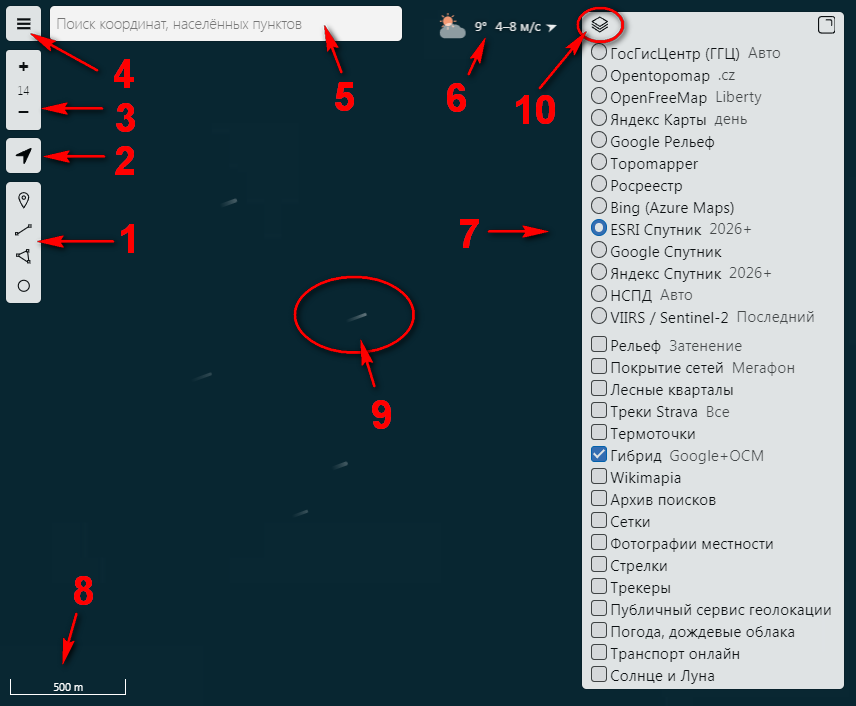

## Основные элементы ГИС
1. Инструменты создания объектов (метка, маршрут, полигон, окружность)
2. Текущее местоположение устройства (где я)
3. Масштаб
4. Главное меню (импорт треков и сеток, подключение DMR трекеров, управление объектами, выбор языка, печать, о проекте, вход в систему)
5. Поиск
6. Метеоданные (в точке по центру карты)
7. Карты и слои
8. Масштабная линейка
9. Направление ветра
10. Выбор набора слоёв и видимых архивных треков

При нажатии на правый Alt (Windows/Linux) или правый Option (MacOS) на карте пропадают метки, маршруты и полигоны. 

При нажатии на правый Shift на карте пропадают инструменты.

При перемещении карты, включении слоёв или изменении масштаба адрес страницы меняется и содержит состояние карты за исключением созданных объектов (меток, маршрутов). Если текущий адрес скопировать и открыть на другом устройстве, то будет видно то же место, с тем же набором карт. Например, [https://gis.extremum.org/#z=20&c=59.8851,29.9092&l=gSat](https://gis.extremum.org/#z=20&c=59.8851,29.9092&l=gSat).

## Авторизация
Для авторизации в системе требуется отправить боту в Telegram (@extremum_sasbot) команду **/login**. В ответ бот пришлет сообщение: "Вставьте полученную ссылку в диалоге входа в систему на https://gis.extremum.org, не пересылайте свою ссылку аутентификации и не делайте её скриншотов
https://layers.extremum.org/front/user/login/XXXXXXX:XXXXXXX:XXXXXXX:XXXXXXX 
Ссылка действительна примерно час".

Авторизованным пользователям становятся доступны следующие возможности:
- режим "мультиплеер", позволяющий нескольким пользователям взаимодействовать друг с другом (может использоваться для консультаций и обучения),
- возможность выбора набора карт и слоев для пользователей из разных стран (в данный момент поддерживаются варианты: по IP адресу, Российская Федерация и Республика Беларусь),
- более частое обновление слоя с транспортом: каждую секунду вместо одного раза в 5 секунд для неавторизованных пользователей,
- дополнительные слои (в данный момент - геолокация),
- индивидуальный учёт квот по учётной записи, не зависящий от других пользователей с тем же IP-адресом (например, в штабе ПСР или в мобильной сети),
- карта не ограничивается границами РФ и РБ,
- возможность удаления своих фотографий.

### Сводка вызовов и прямые затраты проекта за ваши запросы

Во время активного поиска — например, когда при опросе нужно проверить оператора и регион телефонного номера потерявшегося или рассмотреть базовые станции вокруг района ПСР — часть обращений уходит во внешние платные справочники. Чтобы было понятно, какую нагрузку создаёт устройство и в какие прямые затраты для проекта обходятся такие обращения, в главном меню в окне **«Вход в систему»** (после авторизации — **«Учётная запись»**) показывается сводка использования.

В сводке могут отображаться два раздела с разным сроком учёта:

- **«Вызовы API, последние 30 дней»** — общее число обращений к серверам ГИС за последние 30 суток: **«С вашего логина»** (суммарно со всех ваших авторизованных устройств), **«Из этого приложения»** (текущий браузер или установленное приложение) и **«С текущего IP-адреса»**. В штабе ПСР, общей Wi‑Fi сети или мобильной сети один внешний IP-адрес часто делят сразу несколько участников, поэтому счётчик по IP обычно выше личного.
- **«Прямые затраты проекта за ваши запросы с \<дата\>»** — появляется только тогда, когда ваши запросы привели к прямым расходам проекта у внешних поставщиков данных. Этот счётчик хранится с точностью до дня в **скользящем окне до одного года (365 дней)**: пока с начала ведения учёта не прошёл полный год, указывается дата его запуска, а спустя год начальная дата ежедневно сдвигается на сутки вперёд. Суммы также показываются отдельно для логина, приложения и текущего IP-адреса.

Сейчас в прямых затратах проекта учитываются два вида обращений:

- **Проверка российского номера телефона в поиске — `0,1 ₽`** за каждое обращение к внешнему справочнику, если этого номера ещё нет в семидневном серверном кэше. Повторная проверка уже сохранённого в кэше номера новых затрат не вызывает.
- **Подгрузка новых участков базовых станций в слое «Покрытие сетей» — `10 ₽`**, если ваш запрос оказался самым первым некэшированным обращением за текущие сутки среди всех серверов ГИС (плата за активацию суточного доступа у внешнего источника). Остальные запросы базовых станций в те же сутки в пределах квоты, а также просмотр участков из 30-дневного серверного кэша дополнительных затрат не добавляют.

В этом разделе показываются **только прямые затраты проекта за ваши запросы к внешним платным сервисам**. Затраты на само содержание и поддержание работы системы — аренду серверов, хранение карт и треков, сетевой трафик, фоновое обновление спутниковых и метеорологических слоёв — здесь **пока не учитываются** (часть инфраструктуры предоставляют спонсоры проекта, подробнее в разделе [«О проекте»](/about.html)). Поэтому отсутствие строки с затратами означает лишь то, что ваша работа шла через бесплатные источники и серверный кэш, а аккуратная подготовка поисковых запросов и выбор района до приближения базовых станций напрямую экономят средства проекта и его спонсоров. Показатели обновляются с задержкой около секунды и видны при следующем открытии окна **«Учётная запись»**.
