Разделение на карты и слои условное, по аналогии с SAS Planet, карты - это непрозрачные подложки в виде спутниковых снимков или топографических карт, а слои - это отображаемые поверх карт дополнительные данные.

> ##### Если название слоя написано серым
> Если название слоя написано серым цветом, и на него нельзя нажать, это значит, что вы смотрите слишком мелкий или слишком крупный масштаб, нужно приблизить или, наоборот, отдалить карту.

> ##### Горячие клавиши
> У некоторых слоев есть "горячие клавиши", отображаемые серой заглавной буквой после названия слоя. Нажатие на соответствующую клавишу клавиатуры включает и выключает слой. Например, нажатие **K** включает калькулятор Солнца и Луны.

## Данные о погоде
Вычисляются для центра карты на экране, видны на крупных масштабах. В случае плотных дождевых туч информация о точном значении дождя может быть неточной — тучи движутся быстро, а прогноз погоды вычисляется раз в час, уточняйте погодные данные на слое «Ветер, дождевые облака».

#### Метеорологические модели и источники данных
Данные о погоде рассчитываются на основе современных глобальных численных моделей атмосферы и гидросферы:
- **Ветер у поверхности и на высотах, температура, влажность (точка росы), процент облачности, высота нижней границы облаков и осадки** поступают из глобальной прогностической модели **ECMWF** (Европейский центр среднесрочных прогнозов погоды).
- **Морское волнение и высота волн** рассчитываются по специализированной глобальной волновой модели **ECMWF WAM**.
- **Туман** моделируется на основе прогностической модели **DWD ICON** (Метеорологическая служба Германии).
- **Пожарная опасность растительности** рассчитывается по метеорологическому индексу пожарной опасности **FWI** (*Fire Weather Index*) исследовательской модели **Intersucho**, учитывающей температуру, влажность воздуха, скорость ветра и динамику высыхания лесной подстилки.
- **Фактическая спутниковая облачность на обзорных масштабах** формируется в реальном времени по данным группировки геостационарных метеорологических спутников **EUMETSAT Meteosat**, **NOAA GOES** и **JMA Himawari** в видимом и тепловом инфракрасном диапазонах спектра.

#### Как рассчитываются и обновляются прогнозы
Глобальные гидродинамические суперкомпьютерные модели атмосферы (**ECMWF**, **ECMWF WAM**, **DWD ICON**) устроены не так, как локальные датчики у дома: они не могут пересчитывать трёхмерное состояние всей земной атмосферы каждую минуту. Для каждого расчётного цикла суперкомпьютеры собирают колоссальный массив фактических наблюдений со всей планеты — данные сотен метеорологических спутников, высотных радиозондов, самолётов, метеорологических радаров, морских буев и десятков тысяч наземных станций.

Затем на основе уравнений физики атмосферы запускается полный трёхмерный численный расчёт движения воздушных масс. Такие масштабные вычисления выполняются регулярными синоптическими циклами — как правило, 2–4 раза в сутки от стандартных опорных сроков Всемирного координированного времени (00:00 и 12:00 UTC, либо каждые 6 часов). На сбор, проверку и объединение данных наблюдений, сам численный расчёт на суперкомпьютере и формирование пространственных карт прогноза уходит от трёх до пяти часов.

Наша система непрерывно отслеживает публикацию свежих расчётных циклов для каждой метеорологической модели независимо. Как только суперкомпьютер завершает формирование очередного глобального расчёта, система автоматически переключается на новейшие данные, выбирая часовой шаг прогноза, в точности соответствующий текущему реальному времени (а для пожарной опасности растительности **Intersucho** — суточный шаг на текущий день).

Благодаря этому, даже когда разные мировые прогностические центры завершают свои расчёты в разное время суток, на карте всегда отображается самый актуальный и физически согласованный прогноз погоды, действующий именно в текущий час.

#### Туман
Слой тумана формируется по данным модели **DWD ICON** и учитывает основные физические механизмы его образования: ночное выхолаживание земной поверхности в ясную погоду, натекание тёплого влажного воздуха на холодную землю или воду, а также замерзающий туман (с образованием изморози).

> ##### Практическое замечание для поиска (ПСР)
> Отображаемый на карте региональный туман существенно снижает дальность видимости и исключает возможность ориентирования потерявшегося по Солнцу, Луне или перемещению облаков. В то же время местный приземный (низинный) туман в ложбинах, поймах рек, на болотах, торфяниках и лесных полянах в утренние и вечерние часы может формироваться локально, даже если в региональной модели общий признак тумана отсутствует.

#### Примеры
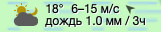

 На небе одновременно находятся Солнце и Луна. Они закрыты плотными, непрозрачными облаками. Ветер 6 метров в секунду порывами до 15 м/с, +18 градусов по Цельсию, небольшой дождь. Порывы ветра, если они на местности достаточно стабильны, уже могут позволять ориентировать потерявшихся по направлению ветра.

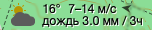

На небе находится Солнце. Закрыто плотными облаками. Сильный ветер, что уже позволяет ориентировать некоторых потерявшихся по направлению ветра, особенно в моменты порывов, +16 градусов по Цельсию, сильный дождь. На слое «Ветер, дождевые облака» можно будет видеть форму туч и оценить моменты усиления или ослабления дождя.

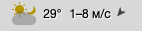

На небе Солнце и Луна, облачность неполная (солнце просвечивает через значок тучи). +29 градусов по Цельсию, почти штиль (1 м/с), но могут быть заметные порывы ветра (8 м/с). Ориентировать потерявшихся лучше всего по Солнцу.

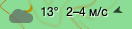

Слабый ветер, переменная облачность, Луна, +13 градусов по Цельсию. Ориентировать потерявшихся не получится, передвижение ночью опасно, а облачность не даёт Луне освещать землю.

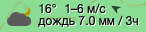

Ночь, сильный дождь, плотная облачность закрывающая Луну. Пострадавшим передвигаться в таких условиях опасно.

## Погодные предупреждения

Слой «Предупреждения» показывает территории, для которых опубликованы сообщения об опасных погодных явлениях: сильном ветре, грозах, осадках, наводнениях, жаре, морозе и других угрозах.

Цвет заливки обозначает уровень опасности, переданный источником: жёлтые и оранжевые оттенки соответствуют умеренным и сильным явлениям, красный — чрезвычайным. Значок помогает определить тип угрозы. В подсказке приведены название явления, описание и рекомендации, если они есть в исходном сообщении.

Граница предупреждения обозначает территорию, к которой относится сообщение. Она не показывает точное положение грозы, осадков или другого явления: предупреждение может охватывать целый административный район. Для оценки обстановки сопоставляйте его с прогнозом и другими погодными слоями.

Одно предупреждение может относиться к нескольким раздельным участкам. Поэтому одинаковый текст в разных местах карты не обязательно означает ошибку. На одной территории также могут одновременно действовать разные предупреждения.

Данные поступают из нескольких источников:

- **Весь мир:** [GDACS](https://new.gdacs.org/) — международная система оповещения о крупных природных бедствиях. Её сообщения могут касаться не только погоды, но и других природных угроз.
- **Европа:** [Meteoalarm](https://meteoalarm.org/en/live/) — предупреждения национальных метеослужб европейских стран.
- **Германия:** [DWD](https://www.dwd.de/DE/wetter/warnungen/warnWetter_node.html) — Метеорологическая служба Германии.
- **Канада:** [ECCC](https://weather.gc.ca/?layers=alert) — Министерство окружающей среды и изменения климата Канады.
- **США:** [NWS, NOAA](https://www.weather.gov/alerts) — Национальная метеорологическая служба США.

Покрытие и подробность сообщений различаются по странам. Данные обновляются периодически; отсутствие предупреждения на карте не означает отсутствия опасности. При планировании поисковых работ уточняйте актуальную обстановку по сообщениям местной метеослужбы.

## Карты
### ГГЦ
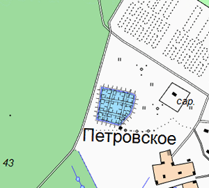

Горячая клавиша: **U**

Охват: **Российская Федерация** на начало нулевых годов до 15 масштаба (некоторые районы могут отсутствовать)

Для данного типа карт можно выбрать масштаб (Авто, 250 м, 500 м, 1 км или 2 км) или отображение карт соревнований по спортивному ориентированию (Московский марш-бросок или Ориентирование).

### OpenTopoMap
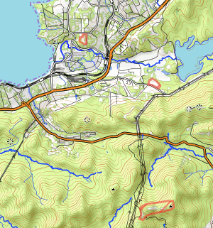

Горячая клавиша: **O**

Охват: **Российская Федерация, Республика Беларусь, Украина, Прибалтика, Казахстан** до 18 масштаба

Варианты: **.cz/.org**

Обновления некоторых территорий приостановлены в начале 2022 года из-за систематического вандализма в OpenStreetMap. Вопросы по содержимому и обновлениям можно адресовать автору ресурса [на форуме OpenStreetMap](https://community.openstreetmap.org/t/opentopomap-cz-opentopomap/88880).

### OSM Топо
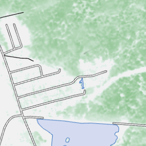

Охват: **весь мир**.

Варианты: **День / Ночь / Схема**.

При подготовке поиска полезно видеть одновременно дороги, границы леса и характер растительности. OSM Топо объединяет объекты **OpenStreetMap** со спутниковыми оценками высоты деревьев и ночного освещения. Это позволяет заметить различия между участками, которые на обычной карте обозначены одинаковой зелёной заливкой.

Карта собирается как несколько прозрачных листов: внизу находится фон местности, поверх него — дополнительные спутниковые данные, затем дороги, здания, водоёмы и подписи. Поэтому спутниковая окраска леса может отличаться от его границы в OpenStreetMap: эти сведения получены разными способами и относятся к разному времени.

#### «День»: высота и сезонная окраска леса

В дневном варианте выраженность окраски зависит от расчётной высоты деревьев: при одинаковом типе растительности высокий лес обычно выглядит темнее низкого. Оттенок дополнительно помогает различать хвойную и лиственную составляющие.

Высота крон оценивается по спутниковым изображениям с помощью машинного обучения. Такая оценка описывает верхнюю поверхность леса. Она помогает отличать высокий древостой от низкой поросли, но сама по себе не показывает густоту подлеска, валежник и удобство прохода группы.

Лиственная растительность меняет окраску в течение года: от летних зелёных оттенков к осенним жёлтым и зимним сероватым. Хвойная составляющая сохраняет более устойчивый зелёный цвет; промежуточные оттенки получаются при смешении составляющих.

Сезон определяется расчётным способом. Используется адаптированная **биоклиматическая модель Хопкинса**, связывающая сроки сезонного развития с географической широтой и высотой местности, в сочетании с годовым изменением положения Солнца. Выше в горах весеннее развитие запаздывает, а осенние изменения наступают раньше. Это позволяет избежать ситуации, когда лес в тёплой низине и на холодном горном склоне одновременно перекрашивается по одной календарной дате.

Модель не наблюдает распускание листьев на каждом участке. Необычно тёплая весна, засуха или ранние заморозки могут сдвинуть реальные сроки относительно расчётных. Поэтому сезонный цвет помогает читать карту, но не заменяет свежий снимок или сообщение группы с места.

#### Как учитываются изменения леса

Исходная карта высот постепенно устаревает: появляются вырубки, гари и молодая поросль. Для уточнения система использует сведения о потере лесного покрова и сравнивает летние подборки снимков **Sentinel-2** с опорным периодом.

Сравнение опирается на **NDVI** — индекс растительности — и **NBR**, чувствительный к изменениям растительного покрова, в том числе после пожаров. Эти индексы рассчитываются по тому, как поверхность отражает свет в разных спектральных диапазонах. Изменение их сочетания позволяет скорректировать отображаемую высоту; для восстановления растительности предусмотрена ограниченная поправка на рост.

Это косвенная оценка изменений, а не повторное измерение каждого дерева. Например, ослабление окраски после потери крон не означает, что участок стал удобен для движения: там могут оставаться стволы и густой подрост.

При приближении крупнее масштаба 16 появляются дополнительные условные знаки растительности и подписи расчётной высоты. Если доступен год потери лесного покрова, он также указывается рядом со знаком.

#### «Ночь»: где заметно искусственное освещение

Ночной вариант добавляет свечение по данным спутникового прибора **VIIRS**. Используется годовая подборка наблюдений за **2023 год**, поэтому яркие пятна помогают находить устойчиво освещённые населённые пункты и промышленные территории. При подготовке подборки отбрасываются многие случайные вспышки и помехи; подробнее — в [описании метода Elvidge и соавторов, 2021](https://doi.org/10.3390/rs13050922).

Свечение показывает свет, зарегистрированный спутником. Видимость огней для потерявшегося зависит ещё и от рельефа, деревьев, погоды и направления взгляда. По этой карте также нельзя определить, включено ли освещение сегодня.

При приближении свечение постепенно ослабевает и исчезает к масштабу 16, открывая подробности карты.

#### «Схема»: спокойный фон для рабочих объектов

Выберите «Схему», когда важнее хорошо различать треки групп, метки, границы участков и другие рабочие объекты. Она особенно полезна как фон для пользовательских объектов: они остаются заметными, а сама карта выглядит сдержанно и не перетягивает внимание на себя. В этом варианте используется светлая карта OpenStreetMap без дополнительной спутниковой окраски леса и ночного свечения.

Чтобы рассмотреть склоны и горизонтали поверх любого варианта, отдельно включите слой «Рельеф».

### Яндекс Карты
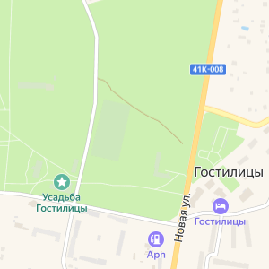

Горячая клавиша: **M**

Охват: **весь мир**

Варианты: **день/ночь**

### Google Terrain
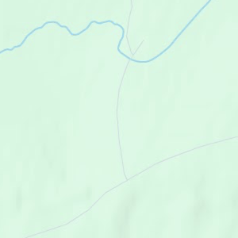

Горячая клавиша: **N**

### TopoMapper
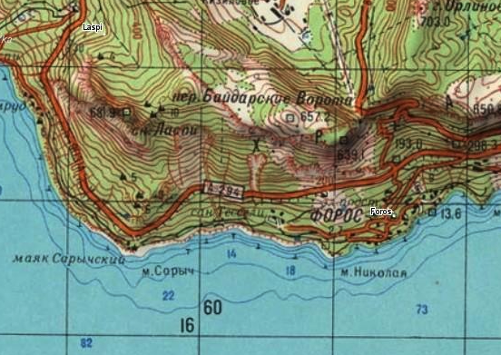

Горячая клавиша: **B**

Охват: **весь мир** до 13 масштаба

Об источнике [на OpenStreetMap Wiki](https://wiki.openstreetmap.org/wiki/Topomapper).

### Росреестр
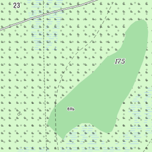

Горячая клавиша: **R**

Охват: **Российская Федерация**, максимальный масштаб переменный — выше в городах, ниже в природной среде

Официальная современная топографическая карта, например, с трассой М11 и Керченским мостом. Содержит самые последние данные о лесных кварталах. Карта представляет границы Российской Федерации на конец 2022 года. Источник: [https://pkk.rosreestr.ru](https://pkk.rosreestr.ru)

### Bing Satellite (Azure Maps)
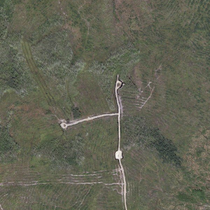

Горячая клавиша: **V**

### ESRI Satellite
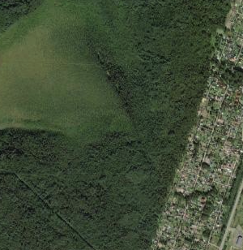

Горячая клавиша: **I**

Охват: **весь мир**

Варианты: **годы** снимков. Выбранный год не означает, что именно так выглядела местность в это время, а означает, что на начало указанного года в источнике были соответствующие снимки

### Google Satellite
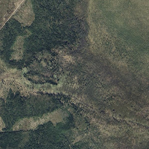

Горячая клавиша: **G**

По умолчанию используется вариант **«Открытый»**, доступный всем. После входа в ГИС можно выбрать **«Последний»** или год съёмки. Вариант **«Последний»** показывает самые свежие снимки в архиве, которые могут быть новее снимков в варианте **«Открытый»**. Доступны все годы с **2025 по 2009** включительно, а также **2005, 2000, 1995, 1990 и 1985**. Наличие снимков за выбранный год зависит от района.

Для всех исторических вариантов, включая **«Последний»**, действует строгий лимит на число запросов. Если лимит исчерпан, новые участки снимков загрузятся только после его восстановления. Исторические варианты нельзя заранее скачать для работы без интернета через команду **«Скачать карты...»**. Если в районе поиска не будет связи, заранее скачайте другую подходящую подложку.

### Яндекс Спутник
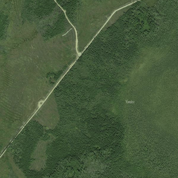

Горячая клавиша: **Z**

Для спутниковых снимков Яндекса есть возможность выбрать год снимка. Если снимок за выбранный год отсутствует, то будет показан ближайший предыдущий снимок (например, за 2021 год, если выбран 2023 год, но съемка в 2023 и 2022 годах не осуществлялась).

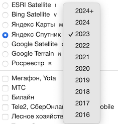

### Национальная система пространственных данных
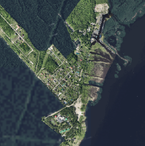

Варианты: **Авто/2000/10000/Base**

### VIIRS / Sentinel-2
Горячая клавиша: **S**

Набор оперативных спутниковых подложек, объединяющий детальную оптическую съёмку земной поверхности и ежедневные обзорные снимки со спутников наблюдения Земли:
- **Обзорные мозаики Sentinel-2 и Landsat («Мозаика Sentinel-2», «Мозаика Landsat»)** — готовые композитные снимки с разрешением 10–30 м (спутники **Sentinel-2A, Sentinel-2B, Sentinel-2C** европейской программы Copernicus и **Landsat 8, Landsat 9** NASA/USGS).
- **Точечные оперативные выборки Sentinel-2 («Самый последний», `☁ < 75%`, `☁ < 40%`, `☁ < 25%`, `☁ < 15%`, `☁ < 5%`)** — динамически рассчитываемые снимки на масштабах от 9 и крупнее: либо самый свежий пролёт независимо от облачности, либо подборка с ограничением допустимой облачности.
- **MODIS (аппараты NASA Terra и Aqua)** и **VIIRS (аппараты NOAA/NASA NOAA-20 и NOAA-21)** — ежедневные обзорные снимки широкого захвата ([подробнее о приборе VIIRS на сайте NASA](https://www.earthdata.nasa.gov/data/instruments/viirs/resources)), позволяющие оперативно оценивать ледовую обстановку, снежный покров, паводки, дымовые шлейфы и крупные лесные пожары.

#### Ограничения использования, квоты и рекомендуемый порядок работы с Sentinel-2
Расчёт динамических вариантов **Sentinel-2** («Самый последний» и `☁ < 75%` … `☁ < 5%`) выполняется в рамках **некоммерческого (Non-Commercial) организационного тарифа** со строгим общим месячным лимитом вычислительных ресурсов. При исчерпании этого общесистемного месячного лимита обработка запросов либо замедляется в 10 раз, либо начинает возвращать частичные ответы с пропусками покрытия. Переход на коммерческий тариф стоимостью от $3000 в месяц неподъёмен для открытой некоммерческой системы, поддерживаемой некоммерческой поисково-спасательной организацией.

Чтобы защитить общий месячный ресурс от преждевременного исчерпания и сохранить работу слоёв для реальных ПСР на протяжении всего месяца, в системе действуют также **индивидуальные пользовательские квоты**:
- **Рекомендуемый способ обзора территории:** начинайте просмотр района на **обзорных мозаиках («Мозаика Sentinel-2», «Мозаика Landsat»)** или ежедневных слоях **VIIRS / MODIS**. Обзорные мозаики **не расходуют** общесистемный месячный лимит динамических расчётов (а индивидуальные пользовательские лимиты для них значительно свободнее).
- **Точечный переход к детальным выборкам:** только после того, как вы приблизили конкретный участок поиска (масштаб 9 и крупнее), переключайтесь на вариант **«Самый последний»** или варианты с фильтрацией облачности.
- **Повышенный расход у малооблачных вариантов (`☁ < 75%` … `☁ < 5%`):** варианты с отбором по низкой облачности расходуют квоту **во много раз сильнее**, чем «Самый последний» снимок, поскольку для сборки безоблачной картины системе приходится сканировать и сопоставлять глубокий исторический архив пролётов.

##### Как отображается состояние квот в интерфейсе
Поскольку у разных вариантов подложки **VIIRS / Sentinel-2** используются разные типы квот (отдельная свободная квота для обзорных мозаик, отдельная строгая квота для динамических выборок Sentinel-2, а варианты MODIS/VIIRS работают без квотирования), индикация отображается как на уровне самой строки слоя, так и отдельно для каждого варианта в выпадающем списке:
1. **В переключателе слоёв и в списке вариантов:** когда остаток квоты по выбранному варианту (или по отдельному варианту внутри выпадающего списка) опускается до **25% и ниже**, строка подсвечивается предупреждающей жёлто-красной полосой заполнения (ширина полосы показывает долю израсходованной квоты). Если квота падает до **0%**, под названием слоя появляется подпись **«Недоступно Xч Yм»** (или **«Квота исчерпана»**) с обратным отсчётом времени до автоматического восстановления (для неавторизованных пользователей временная квота обычно восстанавливается в течение нескольких часов). При этом даже если исчерпана квота на динамические варианты Sentinel-2 (`Самый последний`, `☁ < ...`), вы можете переключить вариант в списке на **«Мозаика Sentinel-2»**, **«Мозаика Landsat»** или **VIIRS / MODIS**, которые продолжат работать.
2. **В окне учётной записи (блок «Вызовы API, последние 30 дней»):** при открытии окна входа/профиля в главном меню отображается сводка выполненных запросов за последние 30 дней (**«С вашего логина»**, **«Из этого приложения»**, **«С текущего IP-адреса»**). В обычном режиме блок имеет синий фон; при снижении остатка хотя бы одной из временных квот до **25% и ниже** плашка становится **оранжевой** с предупреждением об остатке в процентах, а при полном исчерпании (**0%**) — **красной**.

#### Положение спутников в реальном времени и полосы обзора
При выборе любого варианта карты **VIIRS / Sentinel-2**, слоя **Пожары** (**F**) или слоя **Электрички, самолёты, молнии** (**L**) на карте в реальном времени отображается расчётное положение спутников дистанционного зондирования Земли (**Sentinel-2A/2B/2C**, **Landsat 8/9**, **Terra**, **Aqua**, **NOAA-20**, **NOAA-21**), пролетающих над открытым районом карты.

Все эти аппараты находятся на низких околоземных солнечно-синхронных орбитах высотой от 705 до 830 км и движутся со скоростью около 7,4–7,5 км/с, совершая полный виток вокруг Земли примерно за 100 минут. Солнечно-синхронная орбита построена так, чтобы спутник проходил над каждой широтой в одно и то же местное солнечное время — благодаря этому снимки разных дней выполняются при сопоставимом угле освещения местности Солнцем. Координаты, курс, высота орбиты и скорость спутников относительно поверхности Земли рассчитываются в реальном времени по баллистической модели возмущённого орбитального движения [SGP4 / Spacetrack Report No. 3 (Hoots & Roehrich, 1980)](https://celestrak.org/NORAD/documentation/spacetrk.pdf) с учётом сжатия Земли у полюсов (гравитационной гармоники $J_2$).

Рядом со значком спутника на карте подписывается его название, а при наведении указателя мыши во всплывающей подсказке отображаются текущая высота орбиты (в километрах) и путевая скорость относительно поверхности Земли (в км/с).

Вокруг каждого спутника на карте отображаются до двух полупрозрачных прямоугольников мгновенного захвата камеры:
1. **Основная (надирная) полоса съёмки** — полупрозрачная область непосредственно под спутником, где оптические приборы дают максимальное пространственное разрешение без сильных перспективных искажений (ширина полосы составляет **185 км** у *Landsat 8/9*, **290 км** у *Sentinel-2* и около **400 км** для центральной зоны *MODIS* и *VIIRS*).
2. **Широкая полоса обзора тепловых детекторов пожаров** — едва заметная полупрозрачная контурная область для обзорных радиометров **MODIS** (ширина полосы **2330 км**) и **VIIRS** (ширина полосы **3040 км**). На краях такой широкой полосы спутник смотрит на землю под большим углом: тепловая аномалия лесного пожара там по-прежнему фиксируется, но размер пятна на снимке увеличивается, а детальность падает по сравнению с пролётом прямо над районом.

#### Сводка свежести снимков и времени пролёта (в левом нижнем углу)
Когда включена подложка **VIIRS / Sentinel-2** или слой **Пожары**, в левом нижнем углу карты (над масштабной линейкой) появляется краткая сводка по спутникам, соответствующим выбранному слою:
- В заголовке указывается **ближайший предстоящий пролёт** над центром экрана (например, через сколько минут или часов следующий спутник пройдёт над районом поиска).
- Ниже перечислены **три самых свежих прошедших пролёта** (от самого недавнего к более старым) с указанием времени, прошедшего с момента съёмки, и **типичного времени приёма и обработки данных** (*обработка* или *доступно*).

Даже когда спутник уже пролетел прямо над районом ПСР, снимок или тепловые точки пожаров появляются на карте не мгновенно. Низкоорбитальные спутники не находятся в постоянной прямой радиовидимости наземных приёмных станций во всех точках земного шара: выполненная съёмка сначала записывается в бортовую память аппарата и сбрасывается на Землю по радиоканалу только при пролёте над ближайшей доступной наземной станцией приёма. После приёма сигнала выполняются расшифровка, геопривязка по орбитальным данным, радиометрическая калибровка и нарезка картографических тайлов. Для обзорных и пожарных каналов **VIIRS** и **MODIS** весь цикл приёма и обработки обычно занимает **1,5–2 часа**, а для детальных оптических снимков **Sentinel-2** и **Landsat** — **от 4 до 6 часов**. Сводка в углу экрана позволяет сразу понять, стоит ли уже проверять обновление снимка после недавнего пролёта или данные ещё находятся в обработке.

## Слои
### Рельеф
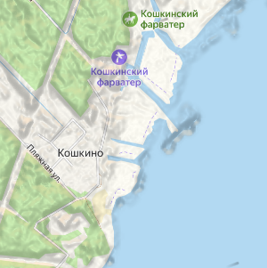

При подготовке маршрута группы бывает трудно понять по спутниковому снимку, где проходит гребень, а где начинается глубокая ложбина: лес скрывает форму земли. Включите «Рельеф» поверх выбранной карты — затенение поможет увидеть общий рисунок склонов, а контуры покажут перепады высоты.

Варианты: **Авто / Затенение / Контуры**.

#### Как работает затенение

Представьте объёмный макет местности, освещённый сбоку: обращённые к свету склоны выглядят светлее, противоположные — темнее. Алгоритм **hillshade**, или отмывка рельефа, создаёт похожее изображение по цифровой модели высот. Для каждого участка система сравнивает высоты соседних точек, оценивает наклон поверхности и рассчитывает освещение. В основе лежит **косинусная модель Ламберта**: поверхность получает больше света, когда лучи падают на неё ближе к прямому углу.

Направление подсветки связано с расчётным положением Солнца, а когда оно за горизонтом и видна Луна — с положением Луны. Контраст и выраженность рельефа дополнительно меняются с масштабом, чтобы формы местности оставались различимыми. Поэтому по темноте участка нельзя определить крутизну склона в градусах или фактическую освещённость под деревьями: для оценки формы склона сопоставляйте затенение с контурами.

Основой служит **FABDEM** — модель высот с шагом сетки около 30 м. Её авторы с помощью машинного обучения уменьшили влияние леса и зданий на спутниковые измерения, приблизив высоты к поверхности земли. Метод описан в [работе Hawker и соавторов, 2022](https://doi.org/10.1088/1748-9326/ac4d4f).

Для затенения система дополнительно учитывает расчётную высоту деревьев. Поэтому на изображении могут выделяться края леса и вырубки. Контуры строятся по модели рельефа без этой добавки: граница высокого леса сама по себе не должна превращаться в склон на горизонталях.

#### Как читать контуры

«Контуры» показывают горизонтали — линии одинаковой высоты. При одном масштабе близко расположенные линии указывают на более крутой склон, широко разнесённые — на более пологий. Например, если кратчайший путь группы пересекает плотный пучок горизонталей, полезно рассмотреть обход и проверить его по топографической карте.

Шаг горизонталей меняется при приближении: на масштабах 13–14 он составляет **20 м**, на 15–16 — **10 м**, начиная с 17 — **5 м**. Эти числа обозначают перепад высоты между соседними линиями, а не точность исходных измерений. Увеличение карты делает рисунок подробнее, но не добавляет в модель новые сведения о небольших канавах, уступах и промоинах.

#### Какой вариант выбрать

В режиме **«Авто»** на обзорных масштабах показывается затенение. Начиная с масштаба 14 появляются контуры, а затенение постепенно исчезает к масштабу 16. Это позволяет сначала увидеть форму всего района, затем рассмотреть склоны на участке работы группы.

Выберите **«Затенение»**, если хотите сохранить объёмный рисунок при приближении, или **«Контуры»**, если важнее читать перепады высот поверх снимка. Если устройство не поддерживает необходимую графику WebGL2, доступен упрощённый вариант **«Рельеф (ЦПУ)»**.

### Покрытие сетей мобильных операторов
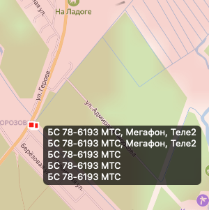

При подготовке выхода группы полезно заранее оценить, где вероятна мобильная связь и какой оператор может оказаться полезнее в районе поиска. Слой показывает опубликованные зоны покрытия, а для российских операторов при наличии доступа — также отдельные значки базовых станций.

| Территория | Варианты |
|:---|:---|
| Россия | **Мегафон / МТС / Т2 / Билайн** |
| Беларусь | **МТС Беларусь / A1 / Life** |
| Малайзия | **Yes / Maxis** |

Выбирайте оператора, SIM-картой которого пользуется группа или потерявшийся. Покрытие другого оператора можно рассматривать для сравнения, но оно само по себе не подтверждает доступность обычных звонков и интернета на имеющейся SIM-карте.

#### Что означает цветная область

Зоны покрытия поступают готовыми изображениями из подключённых картографических источников. Для ряда операторов ГИС совмещает несколько технологий связи: например, у «Мегафона» — **2G, 3G и LTE**, у МТС в России — также опубликованный слой **5G**.

В результате одна цветная область может объединять разные технологии. По её наличию нельзя заключить, что в каждой точке доступен быстрый интернет. Оттенки и прозрачность также зависят от исходной карты и наложения изображений: более тёмное пятно не обязательно означает более сильный сигнал.

Такие карты описывают ожидаемое покрытие. Например, [Maxis прямо указывает](https://www.maxis.com.my/en/about-maxis/maxis-network/network-map/), что фактическая доступность и качество связи зависят от рельефа, условий приёма и используемого устройства.

#### Почему связь меняется на небольшом расстоянии

Радиосигнал распространяется через местность, а не по плоской карте. Холм, склон, здания и растительность ослабляют его и могут закрывать направление на антенну. Поэтому в пределах одного окрашенного участка приём на открытом месте и в глубокой ложбине может заметно различаться.

Базовая станция тоже не похожа на лампочку, одинаково освещающую круг вокруг себя: её антенны обслуживают определённые направления. Ближайший значок станции поэтому не обязательно соответствует лучшему приёму или станции, к которой подключён телефон.

Для планирования сопоставляйте покрытие со слоем **«Рельеф»** и сообщениями групп с места. Карта помогает выбрать участки для проверки связи; фактическую возможность звонка или передачи данных нужно проверять на местности.

#### Что показывают значки базовых станций

Для российских операторов значки появляются на крупных масштабах, начиная примерно с **13**, после входа в учётную запись с необходимыми правами доступа. Самого входа может быть недостаточно: доступ к этим данным ограничен отдельно.

Получение сведений о базовых станциях платное и обходится проекту довольно дорого: запрос новых данных при просмотре карты может приводить к денежным расходам. Работу этой возможности спонсирует один из пользователей проекта — **Иван**.

При наведении указателя показываются обозначение станции и связанные с ней операторы. У одной площадки может быть несколько операторов, поэтому их перечень в подсказке не обязательно совпадает с единственным выбранным вариантом слоя.

Сведения о станциях поступают отдельно от изображений покрытия. Значок отмечает объект из источника данных и не сообщает, работает ли оборудование сейчас, какие антенны включены и насколько загружена сеть.

Отсутствие значков также не означает отсутствия связи: причиной могут быть масштаб, права доступа или неполнота исходных сведений.

#### Насколько свежие данные

Изображения покрытия и сведения о станциях сохраняются в кэше, чтобы повторный просмотр района требовал меньше сетевых запросов. Для многих изображений покрытия серверное хранение настроено на **30 дней**. Это срок использования сохранённой копии, а не расписание обновления сети оператором.

Поэтому слой не предназначен для отслеживания текущих аварий и отключений. Перезагрузка страницы тоже не гарантирует получения новой версии от первоисточника. При подготовке связи на поиск учитывайте реальные проверки оборудования и последние сообщения работающих в районе групп.

### Лесные кварталы
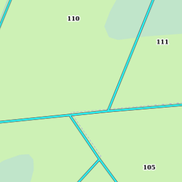

Горячая клавиша: **X**

Охват: **Российская Федерация**.

Потерявшийся сообщил номера на лесном столбе. Слой помогает найти предполагаемый участок леса и сопоставить его с дорогами, водоёмами и спутниковыми снимками. При приближении карты к квартальным границам добавляются сведения о растительности: её типе, расчётной высоте и обнаруженных изменениях лесного покрова.

Эти сведения поступают из разных источников. Квартальная сеть описывает устройство лесной территории, а данные о растительности помогают оценить, что находится внутри неё.

#### Границы и номера кварталов

**Лесной квартал** — пронумерованный участок, используемый при лесоустройстве. Его границы могут проходить по просекам, дорогам и другим ориентирам. Размеры и форма кварталов различаются: считать каждый из них квадратом со стороной один километр нельзя.

Границы и подписи поступают из **Публичной лесной карты ФГИС ЛК** — Федеральной государственной информационной системы лесного комплекса. ГИС получает прозрачные изображения этой карты и накладывает их поверх выбранной подложки. [Информация о системе — на сайте Рослесхоза](https://rosleshoz.gov.ru/information-systems/fgis-lk-information/).

Квартальная часть слоя отображается примерно на масштабах **12–18**. Её удобно рассматривать поверх спутникового снимка: так можно сравнить нанесённые границы с видимыми просеками и дорогами.

Номера кварталов могут повторяться в разных лесничествах. Поэтому совпадение номера в слое само по себе не определяет положение человека: оно имеет смысл вместе с предполагаемым районом и другими известными ориентирами.

Линия квартальной границы помогает искать вероятную просеку, но не подтверждает её проходимость. Просека могла зарасти, пересечь заболоченный участок или оказаться смещённой относительно карты.

#### Что показывают знаки растительности

При приближении, примерно с масштаба **16**, появляются условные знаки деревьев и подписи. Они расставлены по сетке расчётных точек, поэтому каждый знак характеризует небольшой участок возле своей точки, а не весь квартал.

Вид знака помогает различать хвойную, лиственную и смешанную растительность. Для этого используется [классификация растительного покрова **Copernicus за 2019 год**](https://land.copernicus.eu/en/products/global-dynamic-land-cover/copernicus-global-land-service-land-cover-100m-collection-3-epoch-2015-2019-globe) с исходной подробностью около **100 метров**. Она даёт общее представление о типе леса, но может не отражать небольшие участки другого состава и последующие изменения.

Для окраски леса в [**OSM Топо**](#osm-топо) используется другая, более подробная классификация по снимкам **Sentinel-2**, исходная подробность которых в используемом ближнем инфракрасном канале составляет **10 метров**. Поэтому окраска леса в OSM Топо может показывать различия, не отражённые условными знаками слоя «Лесные кварталы». Это разные источники и методы определения типа растительности.

Число рядом со знаком — **расчётная высота древесного полога в метрах**. Пологом называют верхнюю поверхность крон. Например, подпись «18» помогает отличить высокий древостой от низкой поросли, но ничего не сообщает о количестве валежника или густоте подлеска.

#### Как рассчитывается высота

Основой служит глобальная карта высоты полога с исходным разрешением около **1 метра**. Для её построения использованы спутниковые изображения и машинное обучение на основе **DINOv2**. Модель сначала учится распознавать особенности изображений, затем оценщик высоты связывает эти особенности с примерами лазерных измерений леса. Так высоту можно предположить и там, где прямых измерений нет. [Описание метода](https://doi.org/10.1016/j.rse.2023.113888).

Исходные снимки относятся к **2009–2020 годам**, преимущественно к **2018–2020 годам**. Поэтому высокая пространственная подробность этой карты не означает, что она показывает сегодняшний лес.

Если основной источник не вернул значение, система обращается к резервной **карте ETH Zürich за 2020 год** с разрешением **10 метров**. В ней нейросетевая модель объединяет снимки **Sentinel-2** с выборочными лазерными измерениями **GEDI**. Измерения дают примеры высот, а снимки позволяют распространить оценку на остальную территорию. [Исследование метода](https://doi.org/10.1038/s41559-023-02206-6).

В обоих случаях получается модельная оценка. Размер пикселя характеризует подробность исходной карты, а не точность измерения высоты.

#### Как учитываются вырубки и другие изменения

После создания исходной карты лес мог измениться. Чтобы прежняя высота не продолжала обозначать высокий древостой на месте позднейшей вырубки или гари, система проверяет дополнительные сведения.

Сначала используются данные **Hansen Global Forest Change**, полученные по последовательности снимков **Landsat** с подробностью около **30 метров**. Подключённый выпуск содержит годы потери лесного покрова за **2001–2025 годы**. Если для точки зарегистрирована потеря после **2020 года**, прежняя оценка высоты обнуляется. [Исходное исследование](https://doi.org/10.1126/science.1244693).

Дополнительно система сравнивает снимки **Sentinel-2** с опорным **2020 годом**. Для сравнения берутся соответствующие друг другу сезонные периоды продолжительностью **45 дней**. Из подборок исключаются облака, их тени и снег, а оставшиеся наблюдения объединяются по медиане — значению, которое меньше зависит от отдельных необычных наблюдений.

Сравнение опирается на два показателя: **NDVI**, характеризующий растительный покров, и **NBR**, чувствительный к его изменениям, в том числе после пожаров. Они рассчитываются по отражению света в разных спектральных диапазонах. Сильное снижение их сочетания уменьшает исходную высоту, вплоть до нуля.

Это сравнение привязано к **лету Северного полушария**: расчёт использует фиксированные календарные сроки с июля до второй половины августа, без переключения сезона по широте. Вне этого периода используется последняя летняя подборка, поэтому более позднее изменение может ещё не попасть в расчёт. Поправка помогает убрать устаревшую высоту, но не заменяет новое измерение и не даёт достоверной оценки последующего роста молодого леса.

#### Как понимать год и отсутствие высоты

Подпись вида **«с 2022 г.»** связана с обнаруженной потерей лесного покрова. Обычно год берётся из Hansen Global Forest Change и обозначает событие, определённое в этом наборе данных.

Если ежегодный набор ещё не показывает потерю, но сравнение Sentinel-2 уже уменьшило расчётную высоту до нуля, система может указать **текущий год расчёта**. В таком случае подпись не устанавливает точный год произошедшего изменения.

Причину изменения эта подпись тоже не определяет: это могла быть вырубка, пожар, ветровал или другое повреждение. Кроме того, год потери не означает, что участок с тех пор остаётся без растительности.

Когда высота обнулена или пригодная оценка не получена, число возле знака не выводится. По отсутствию числа различить эти случаи нельзя. Сам знак также может отсутствовать из-за масштаба, классификации поверхности, неполных данных или ошибки загрузки.

Поэтому **отсутствие числа или знака не доказывает отсутствие деревьев**. Даже после потери высокого полога на участке могут оставаться стволы, валежник, кустарник и густой подрост. По расчётной высоте и признаку потери полога нельзя определить проходимость участка.

#### Насколько свежа квартальная карта

Квартальные границы обновляются отдельно от данных о растительности. Полученные изображения сохраняются на сервере, причём для этой копии не задано регулярное обновление по фиксированному возрасту. Уже загруженный участок может долго использоваться повторно; перезагрузка страницы не гарантирует получения новой версии первоисточника.

Таким образом, граница квартала, тип леса, исходная высота и поправка на потерю полога могут относиться к разным годам. Подпись года возле растительности не является датой обновления квартальных границ.

### Треки Strava
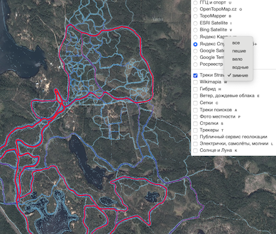

Горячая клавиша: **J**.

На карте не отмечена тропа, но по снимку кажется, что через лес можно пройти. Слой Strava помогает проверить эту догадку: он показывает, где пользователи сервиса записывали спортивные маршруты. Так можно обнаружить используемые дорожки, лыжные трассы и проходы, которых ещё нет в OpenStreetMap.

Варианты: **Все / Пешие / Вело / Водные / Зимние**.

#### Как получается тепловая карта

Представьте, что множество записанных GPS-треков наложили на один прозрачный лист. Повторяющиеся направления становятся заметнее, а редко используемые остаются слабыми. Такой способ обобщения называется **тепловой картой**, или **heatmap**.

В ГИС используется **Strava Global Heatmap**. По [описанию Strava](https://support.strava.com/en-us/articles/16046277-a-guide-to-strava-heatmaps), она объединяет публичные записи активности за последний год и обновляется ежемесячно. Поэтому слой помогает увидеть сложившиеся направления движения, но не показывает, где кто-то прошёл сегодня.

Цветные линии представляют обобщённые данные. По ним нельзя открыть запись конкретного человека, узнать время его прохода или проследить отдельного участника.

#### Что означает яркость линии

Более выраженная линия помогает заметить популярное направление, но её яркость не переводится напрямую в число людей. Повторные тренировки одних и тех же спортсменов тоже участвуют в общей картине.

Кроме того, цвета относительны и зависят от масштаба и района отображения. Сравнивать по яркости число посетителей двух удалённых лесных массивов нельзя — это ограничение отдельно поясняет [сама Strava](https://stravametro.zendesk.com/hc/en-us/articles/360046435193-Can-I-use-the-public-Strava-heatmap-to-compare-how-many-people-are-active-in-one-particular-place-compared-to-another).

Наличие яркой линии также не определяет качество дороги. По ней могли бегать спортсмены, ехать на горных велосипедах или двигаться по снегу. Для автомобиля, носилок и пешей группы это разные условия проходимости.

#### Как выбрать вариант

Начните с **«Все»**, чтобы увидеть общий рисунок маршрутов, затем сравните категории. **«Пешие»** помогают рассматривать направления движения пешком и бегом, **«Вело»** — велосипедные маршруты, **«Водные»** — активность на воде, **«Зимние»** — зимние занятия.

Особенно полезно сравнивать зимнюю и пешую картину. Линия, заметная зимой, может проходить по замёрзшему болоту или водоёму и не соответствовать летней тропе. Водный маршрут также не означает существования прохода вдоль берега.

Если предполагаемый проход совпадает с просекой на снимке, тропой в OpenStreetMap и линией Strava, у вас появляется несколько независимых оснований рассмотреть его при планировании. Состояние прохода всё равно нужно уточнять по свежим сведениям.

#### Почему линии может не быть

В Strava представлена только часть передвижений: не каждый человек записывает маршрут и публикует его в этом сервисе. На картину также влияют настройки приватности и правила включения записей в общую тепловую карту.

Поэтому отсутствие линии не доказывает, что тропы нет или ею никто не пользуется. Например, местные жители могут регулярно ходить к озеру без записи спортивных тренировок.

#### Свежесть и загрузка

В переключателе слой доступен на масштабах **3–15**. Обзорное изображение и более подробные участки загружаются разными способами, поэтому обзор может работать даже при временных затруднениях с детализацией.

ГИС сохраняет полученные изображения в кэше. После обновления карты самим сервисом Strava здесь некоторое время может отображаться предыдущая копия; при сбоях источника сохранённые изображения также могут использоваться дольше.

Даже свежая годовая тепловая карта содержит следы прошлых сезонов. Недавно закрытая дорога, разобранный мост или затопленная тропа могут ещё оставаться заметными. Используйте слой для поиска возможных маршрутов и сопоставляйте их со снимками, рельефом и сообщениями групп.

### Гибрид
Горячая клавиша: **H**

В действительности состоит из нескольких гибридных слоев, между которыми можно переключаться: Google+OSM, Яндекс+OSM, OSM, Яндекс, Google, Морские навигационные знаки, ГГЦ Гибрид, Росреестр Гибрид. Гибридный слой на данных OpenStreetMap рассчитывается нашей системой. Цвета подобраны так, чтобы сочетаться со слоем Яндекса и создавать видимость того, что это - один слой. Могут накладываться и на темные, и на светлые подложки из-за подобранного набора цветов и условных обозначений.

Отличительные особенности:
- отображаются названия населенных пунктов и водных объектов,
- отображаются подземные и надземные трубопроводы, нанесённые на карту OpenStreetMap,
- отображаются линии электропередач (ЛЭП) с условными обозначениями вольтажа,
- тропинки всех видов,
- ручьи, канавы,
- просеки,
- дороги всех видов, включая зимники.

#### Обозначение линий электропередач (ЛЭП)
ЛЭП отображаются сплошной тонкой линией с периодически повторяющимися группами поперечных засечек (штрихов). Количество штрихов в группе указывает на класс напряжения линии по данным OpenStreetMap (аналогично классическим условным знакам топографических карт):

| Класс напряжения | Число засечек | Условный вид | Примечание |
|:---|:---:|:---:|:---|
| **До 110 кВ** (или не указано) | 1 | `--` | Редкие одиночные штрихи |
| **110 кВ** (110–220 кВ) | 2 | `-- --` | Сдвоенные штрихи |
| **220 кВ** (220–330 кВ) | 3 | `-- -- --` | Группа из трёх штрихов |
| **330 кВ** (330–500 кВ) | 4 | `-- -- -- --` | Группа из четырёх штрихов |
| **500 кВ и выше** | 5 | `-- -- -- -- --` | Группа из пяти штрихов (500 кВ, 750 кВ) |
| **Мелкие / распределительные линии** | 1 | `- - -` | Частые одиночные штрихи (`power=minor_line`) |

> ##### Как часто обновляется?
> _Коротко:_ раз в восемь дней.
> 
> _Более полно:_ обычно раз в восемь дней, но могут быть варианты. Сервис сохраняет кеш, если кеш устарел (старше восьми дней) или отсутствует, то происходит обращение к серверам Overpass turbo, и оттуда скачиваются свежие данные. Скачанные данные сохраняются в кеш. Если скачивание не удалось, а кеш есть, то будет использоваться даже устаревший кеш. Он может также понадобиться в случаях, когда разом запрашивается слишком много данных из Overpass turbo, чтобы не перегрузить их серверы и/или чтобы не ждать скачивания новых данных слишком долго.

### Wikimapia
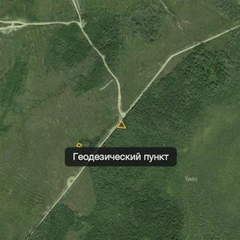

Горячая клавиша: **W**.

На спутниковом снимке видно территорию старого хозяйства, но её название неизвестно. Слой Wikimapia может добавить недостающие сведения: границы объекта, местное название и описание.

Данные создают участники [проекта Wikimapia](https://wikimapia.org/about/): отмечают территории, здания, дороги и другие объекты, дополняют их описаниями и фотографиями. Поэтому слой бывает полезен для местных топонимов и объектов, которых нет на выбранной подложке.

#### Как устроено отображение

Включите слой и приблизьте карту: объекты появляются примерно с масштаба **13**. Они накладываются поверх текущей подложки, поэтому можно одновременно рассматривать снимок и нанесённые участниками границы.

Территории отображаются контурами, а дороги и другие линейные объекты — линиями. Цвет зависит от категории объекта и темы карты: например, водные объекты выделяются синими оттенками. Это оформление помогает различать объекты, но не обозначает проверенность или давность сведений.

Граница показывает, какую территорию участники отнесли к объекту. Она сама по себе не определяет вход, подъезд или положение ограждения на местности.

#### Почему видны не все объекты и подписи

При отображении учитывается размер объекта на экране. По размеру скрываются только контуры территорий, которые занимают слишком большую площадь экрана либо настолько малы, что на них трудно указать даже точным курсором. Поэтому при изменении масштаба контуры могут появляться и исчезать.

Подписи не выводятся у объектов без названия, а также у объектов, отмеченных в самой Wikimapia как объекты без названия.

В **топографической теме**, в том числе на фоне OSM Топо, подписи Wikimapia отключены, а доступные контуры и линии сохраняются. На спутниковом фоне названия могут отображаться, но при наложении подписей часть из них скрывается автоматически.

Отсутствие названия рядом с контуром поэтому не означает, что у объекта нет имени или описания.

#### Как открыть описание

На компьютере наведите указатель на объект, чтобы увидеть доступную подпись. Для открытия подробного описания дважды нажмите по контуру или линии. На сенсорном устройстве используется двойное касание объекта.

Описание загружается отдельно от геометрии. Поэтому сначала на карте может появиться контур, а подробный текст откроется после дополнительной загрузки.

Если для названия есть несколько языковых вариантов, система предпочитает язык интерфейса ГИС, затем использует другие доступные варианты. Поэтому один объект может иметь разные подписи при разных языковых настройках.

Содержание описания относится к записи Wikimapia. Например, историческое название может сохраняться после сноса здания или изменения назначения территории.

#### Поиск и объекты на карте

Поиск по названиям Wikimapia работает отдельно от этого слоя. Включать слой для получения поискового результата не требуется.

Результат поиска помогает перейти к одной точке объекта. Слой позволяет затем рассмотреть его форму и соседние объекты. Например, точка найденного озера открывает нужный район, а контур показывает, к какой части водоёма относится название.

Создание метки возле поискового результата сохраняет точку в пользовательские объекты. Контур и описание Wikimapia в такую метку автоматически не переносятся.

#### Загрузка и обновление

Для подготовки одного участка карты сервер может собирать несколько фрагментов Wikimapia с разной подробностью. Поэтому первая загрузка незнакомого района иногда занимает больше времени, чем повторный просмотр.

Полученные фрагменты с объектами и дорогами сохраняются на сервере на **один месяц**. Это срок использования загруженной копии, а не расписание обновления объектов участниками проекта.

Описание и геометрия загружаются отдельно и могут относиться к разным версиям записи. Перезагрузка страницы также не гарантирует немедленного получения новых границ из первоисточника.

### Архив поисков/Треки/Прочие треки
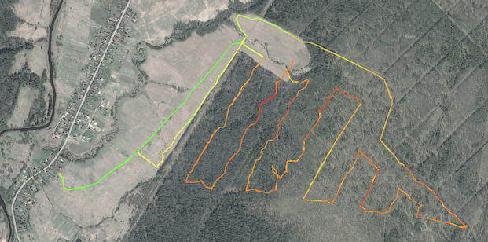

Горячая клавиша: **A**.

Слой показывает записанные треки, полученные из подключённых источников. Их можно наложить на снимок или топографическую карту и рассмотреть вместе с дорогами, просеками и другими объектами.

В отличие от слоя **«Трекеры»**, здесь отображаются обработанные записи из файлов. Конец линии обозначает конец соответствующей записи, а не текущее положение устройства.

#### Откуда поступают треки

**«ЛизаАлерт».** Система периодически проверяет картографический FTP-сервер **maps.lizaalert.ru** и скачивает файлы **PLT** из раздела **`/tracks/`**. Для отбора используются датированные папки источника. Полученные файлы разбираются на сегменты и добавляются в коллекцию отряда; принадлежность к поиску определяется по папке размещения.

Между проверками предусмотрена случайная пауза **3–14 минут**, к которой добавляется время обхода папок и скачивания. Это интервал проверки источника, а не гарантированный срок появления каждого файла.

**«Экстремум».** Источником служат **отчёты о ПСР в базе «Экстремум»**. Система получает список отчётов с приложенными треками, скачивает ещё не сохранённые файлы и связывает их с номером ПСР. Поэтому трек, приложенный к отчёту, не требуется отдельно отправлять боту для попадания в этот источник.

Между проверками списка предусмотрена пауза **10 минут**. После неё выполняются получение списка, скачивание и обработка новых файлов.

При обработке учитывается положение относительно центра ПСР из отчёта. Если центр отдельного сегмента находится дальше **50 км** от указанного центра ПСР, такой сегмент переносится в коллекцию прочих треков. Поэтому часть записи может отображаться в **«Прочих треках»**, хотя исходный файл поступил из базы «Экстремум».

**Telegram-бот.** Файлы **GPX** и **PLT** можно отправить документом боту **[@extremum_sasbot](https://t.me/extremum_sasbot)**. Бот проверяет, удаётся ли распознать файл и извлечь из него трек, затем передаёт его серверам ГИС. Такие записи добавляются в общую коллекцию прочих треков и доступны через **«Архив поисков»** или **«Прочие треки»** в зависимости от режима карты.

Сообщение **«получил, обработал и загружаю в систему»** означает, что файл прошёл первоначальную проверку и передан на загрузку. Его появление на карте следует после обработки серверами.

Для файлов бота учитываются отправитель и имя файла. Если тот же пользователь повторно отправит файл с уже сохранённым именем, бот сообщит, что трек уже есть. Такая отправка не заменяет содержимое ранее принятого файла.

#### Почему меняется название слоя

Состав слоя зависит от выбранного отряда и от того, открыта ли карта конкретного поиска.

| Режим карты | Основной слой | «Прочие треки» |
|:---|:---|:---|
| Отряд не выбран | **«Архив поисков»** объединяет подключённые источники | Отдельный слой не требуется |
| Выбран отряд | **«Треки: …»** показывает треки этого отряда | Показывает остальные источники |
| Открыт конкретный поиск | **«Поиск: …»** показывает записи, связанные с его номером | Показывает записи, не относящиеся к этому номеру |

Таким образом, **«Прочие треки»** дополняют текущий выбор. Их содержимое меняется вместе с режимом карты.

Привязка к поиску берётся из сведений, присвоенных файлам при обработке. Географическая близость линии к месту поиска сама по себе не делает её частью этого поиска.

#### Зачем приближать карту

Треки появляются примерно с масштаба **7**. На обзорных масштабах сервер готовит общее изображение: линии упрощаются, а часть быстрых сегментов не показывается.

При сильном уменьшении каждый обработанный сегмент может быть представлен прямым отрезком между началом и концом. Поэтому обзорная линия не обязательно повторяет все изгибы исходной записи.

Примерно с масштаба **14** включается подробное представление отдельными линиями. Становятся видны дополнительные изгибы и сегменты, появляется возможность получить сведения о записи.

Если обзорная линия выглядит слишком прямой или часть маршрута отсутствует, приблизьте район: подробное представление содержит больше информации.

#### Что означает цвет

Окраска устроена похоже на **информацию о пробках**: красные оттенки соответствуют меньшему расчётному показателю движения, жёлтые — промежуточному, зелёные — большему. Это позволяет быстро заметить различия внутри длинной записи.

Для этого исходный трек делится на сегменты, каждому из которых назначается свой цвет. Основой служит **медианная скорость** между соседними точками. Медиана — значение из середины упорядоченного ряда; она меньше зависит от отдельных выбросов, чем обычное среднее.

В расчёт медианы входят скорости выше **0,5 км/ч**, поэтому цвет не следует читать как среднюю скорость с учётом всех остановок.

Затем учитывается **разброс изменений направления**. При одинаковой медианной скорости сегмент с более изменчивым направлением может получить цвет, соответствующий меньшему показателю. Поэтому извилистое движение может выглядеть «медленнее» прямолинейного даже при сходных скоростях между точками.

Сходство с картой пробок относится к способу чтения цветов. Здесь они рассчитываются по координатам и времени конкретной записи, включая поправку на изменения направления. Ошибки положения, неверные часы устройства и нерегулярная запись точек могут влиять на результат.

#### Как посмотреть сведения о записи

В подробном представлении наведите указатель на линию. Подпись формируется из доступных сведений: номера поиска, названия трека или файла и времени первой точки соответствующего сегмента.

У одного исходного файла может быть несколько сегментов, поэтому их время начала может различаться.

Для части источников предусмотрена ссылка на исходную запись. На компьютере она открывается двойным нажатием по линии; на сенсорном устройстве — двойным касанием. Доступность ссылки зависит от источника трека.

#### Как обновляются данные

Путь нового трека состоит из нескольких этапов: файл появляется в источнике, поступает на серверы ГИС, разбирается на сегменты и включается в ответы карты.

Чтобы повторные просмотры одного района работали быстрее, подготовленные участки карты сохраняются в кэше. **При получении новых файлов серверный кэш треков сбрасывается**, поэтому обновлённым данным не требуется ждать обычного срока его истечения.

После получения и обработки файлов серверы могут отдавать обновлённую карту как можно скорее. При этом уже открытая карта показывает загруженную браузером копию до следующего получения данных.

### Сетки
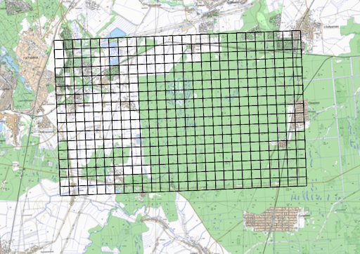

Горячая клавиша: **C**.

Когда штаб и группы пользуются одной поисковой сеткой, проще обсуждать район по радиосвязи: вместо длинного описания местности можно назвать обозначение узла или участка. Слой «Сетки» показывает готовые поисковые сетки **«ЛизаАлерт»**, полученные с картографического FTP-сервера **maps.lizaalert.ru**.

Сетка привязана к местности координатами своих узлов. Это похоже на прозрачный лист клетчатой бумаги, закреплённый поверх карты: при переключении подложки узлы остаются в тех же местах. Положение, шаг и обозначения задаются исходными файлами. Перед постановкой задачи уточните, что штаб и группа используют одну версию сетки.

#### Откуда берутся файлы

Система проверяет два раздела источника:

| Раздел | Какие файлы используются |
|:---|:---|
| Корневой каталог `/` | Архивы с точным именем **`3-Points.zip`**, внутри которых находится GPX-файл сетки |
| Каталог `/tracks/` | GPX-файлы, имена которых заканчиваются на **`m.gpx`**, например `Сетка_500m.gpx` или `Сетка_1000m.gpx` |

Второе правило относится к окончанию имени: файл не обязан называться буквально `m.gpx`. Например, `Орлово_500m.gpx` подходит для автоматического скачивания, а `Орлово.gpx` — нет. Буква **m** в этих примерах латинская.

Внутри GPX хранятся координаты, линии и подписанные точки. Для специального формата сетки система умеет соединять соседние узлы по буквенно-цифровым именам: например, **A1** с **A2** и **B1**. Здесь важна последовательность обозначений: пропущенный узел не восстанавливается по предполагаемому шагу. Для такого построения используйте имена вроде **A1**, без ведущего нуля в числовой части.

Если в архиве несколько GPX-файлов, используется первый найденный, поэтому складывать несколько разных сеток в один `3-Points.zip` не стоит.

#### Почему важно имя папки

Для отбора свежих поисков система читает **дату в начале имени папки**, а не время её изменения на сервере. Надёжный вариант размещения — файл непосредственно внутри папки вида **`ГГГГ-ММ-ДД_Название`**:

```text
/2026-11-01_Орлово/3-Points.zip
/tracks/2026-11-01_Орлово/Орлово_500m.gpx
```

Дата должна быть настоящей и стоять в начале имени. Например, `2026-11-01_Орлово` подходит, а `Орлово_2026-11-01` — нет. Изменение времени файла на FTP не делает старую папку новым поиском.

У разных этапов обработки правила немного отличаются. Скачивание распознаёт также компактную дату вроде `20261101`, но первоначальная загрузка сохранённых сеток требует дефисов — `2026-11-01`. Поэтому используйте вариант с дефисами.

Произвольная вложенность папок тоже нежелательна. При первоначальной загрузке проверяется дата **непосредственно той папки, где лежит файл**. Если перенести архив из датированной папки в подпапку `Карты`, он может скачаться, но не попасть в первоначальную загрузку после перезапуска сервиса.

#### Как часто обновляется карта

Обновление проходит в два этапа: сначала сервер скачивает файлы источника, затем браузер получает подготовленные сетки.

В настройках, поставляемых с системой, перед очередным обходом FTP выбирается случайная пауза **от 3 до 14 минут**. К ней добавляется время обхода каталогов и скачивания. Поэтому это не расписание «строго каждые 15 минут»: при большом числе файлов или проблемах связи проверка занимает дольше.

Для включённого слоя браузер запрашивает данные примерно раз в **15 минут**. Новая сетка появляется после прохождения обоих этапов; пятнадцатиминутный интервал браузера не является сроком доставки файла от источника до экрана.

Для скачивания в основной конфигурации рассматриваются папки примерно за последние **40 дней**. При первоначальной загрузке с диска действует отдельный предел — **15 дней по дате папки**. Более старые файлы могут снова добавиться при последующей FTP-проверке. Эти два числа относятся к разным этапам и не задают точный срок исчезновения сетки с карты.

#### Исправления, переименование и удаление

Для экономии передачи данных FTP-файл сравнивается с локальной копией **по размеру**. Если координаты исправили, но число байтов осталось прежним, новая версия может не скачаться. Например, замена одной цифры в координате другой цифрой обычно не меняет размер файла. Одного обновления времени изменения недостаточно — при таком случае сообщите сопровождающим системы.

После получения изменённого локального файла система проверяет его содержимое. Новая успешно прочитанная версия по тому же пути заменяет прежнюю сетку. При ошибке чтения или обработки уже опубликованная версия может сохраниться.

Переименование файла или перенос в другую папку воспринимаются как другой путь. Поэтому новая сетка может появиться рядом со старой. Удаление файла с FTP также не означает немедленного удаления его сохранённой копии из системы: уже загруженная сетка может оставаться на карте.

Очень короткие файлы — меньше **200 байт** — при скачивании пропускаются. Повреждённый архив или файл неподдерживаемого формата также может не дать новой сетки на карте.

#### Как пользоваться слоем

Переместите карту к району поиска и включите слой клавишей **C**. В переключателе он доступен на масштабах **9–15**. Если подписи узлов скрыты, приблизьте район; для спокойного фона удобно выбрать **OSM Топо → Схема**.

Слой передаёт геометрию и обозначения сеток. Назначение групп, пройденные участки и результаты осмотра нужно учитывать отдельно. При обрыве связи уже загруженные данные могут оставаться на экране, поэтому наличие сетки само по себе не подтверждает её актуальность. Сверяйте версию и обозначения с сеткой, выданной штабом.

### Фото местности
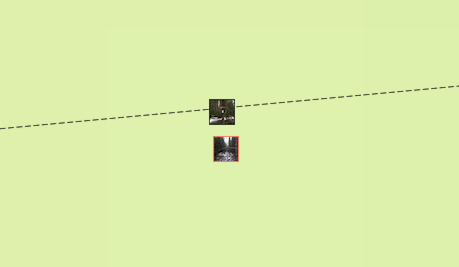

Горячая клавиша: **P**.

По спутниковому снимку видно дорогу через ручей, но непонятно, сохранился ли мост. Уже имеющаяся фотография с места помогает рассмотреть переправу, состояние дороги, ориентир или препятствие, которое сверху не различить.

Слой показывает фотографии, переданные участниками поисково-спасательных работ через Telegram-бота **@extremum_sasbot**. Они становятся доступны другим пользователям карты. Описанный ниже порядок предназначен для спасателей, добавляющих материалы о местности; он не является рекомендацией поручать съёмку и отправку фотографий потерявшемуся.

#### Откуда берётся точка на карте

Камера телефона может сохранять внутри файла служебные сведения — **метаданные EXIF**. Среди них бывают координаты и время. ГИС читает эти координаты и размещает фотографию на карте.

Геометка обычно обозначает **место, где находился фотограф**, а не положение предмета в кадре. Например, снимок моста с берега будет расположен у точки съёмки. Если мост находится вдалеке, миниатюра фотографии не указывает его точные координаты.

ГИС не определяет место по изображению и не исправляет ошибочную геометку по узнаваемым объектам. Если телефон сохранил неточные координаты, снимок окажется в соответствующей точке. При оценке привязки сопоставляйте изображение с дорогами, береговой линией и другими ориентирами.

#### Как добавить фотографию

Если вы как участник поисково-спасательных работ снимаете местность для ГИС, заранее включите сохранение местоположения в настройках своей камеры и разрешите ей доступ к геоданным. После включения телефона или выхода из помещения определение координат может занять некоторое время.

Отправьте исходный файл боту **как документ**, сохранив геометку. При обычной отправке сжатого изображения координаты могут быть удалены. Сам факт, что на телефоне включена геолокация, ещё не означает, что координаты записаны в конкретный файл.

Бот сообщает, удалось ли прочитать геометку. Если её нет, простая повторная отправка того же файла не добавит координаты. Подробный порядок действий приведён в разделе [«Как добавлять фотографии местности»](/telegram-bot.html#как-добавлять-фотографии-местности-в-гис-для-псо).

Подтверждение бота означает, что координаты прочитаны и фотография передана на дальнейшую обработку. Перед фоновой обработкой предусмотрена задержка **5–15 секунд**; к ней добавляются очередь, скачивание и подготовка миниатюр. Это не гарантированный срок появления на карте.

#### Как посмотреть подробности

Включите слой и приблизьте район: миниатюры появляются на крупных масштабах, начиная примерно с **13**. При наведении указателя показывается описание с данными автора и временем из сохранённых сведений. На очень крупном масштабе подпись появляется непосредственно рядом с миниатюрой.

Нажмите на фотографию, чтобы открыть увеличенный просмотр. Используйте кнопки **«+»**, **«−»** и **«Подогнать»**. Колесо мыши меняет увеличение; на сенсорном экране можно раздвигать изображение двумя пальцами и перемещать его.

Оценивайте не только содержание, но и давность снимка. Фотография хорошего моста, сделанная до паводка, не подтверждает его нынешнее состояние. Время берётся из метаданных файла и может быть неверным, если часы камеры были настроены неправильно или сведения изменились при обработке изображения.

#### Как удалить фотографию

Войдите в учётную запись, связанную с Telegram-аккаунтом, которому принадлежат снимки. Для доступной вам фотографии откройте контекстное меню и выберите **«Удалить»**. Удалять чужие фотографии могут также назначенные модераторы.

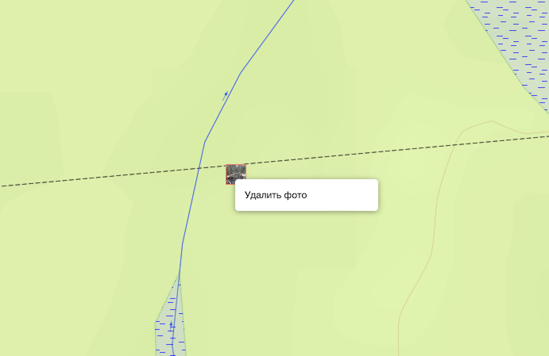

Для нескольких снимков удобнее открыть **«Управление объектами» → «Мои фотографии»**. Вкладка доступна после входа при наличии соединения с сетью. В таблице можно посмотреть координаты и размеры файлов, выбрать несколько фотографий и удалить их с подтверждением.

Удаление относится к копии в ГИС. Оригинал на телефоне и сообщение в Telegram остаются у вас. Уже загруженные изображения на других устройствах могут некоторое время сохраняться в кэше.

#### Если снимок не появился

Проверьте ответ бота, включённый слой и масштаб карты. Дайте обработке завершиться: существующий кэш карты может ещё содержать прежний список фотографий.

Если бот сообщает об отсутствии геометки, проверьте именно отправленный файл. Для некоторых вариантов HEIC чтение метаданных может не поддерживаться; бот предложит попробовать JPG. При преобразовании важно сохранить координаты — смена формата сама по себе их не восстанавливает.

### Стрелки
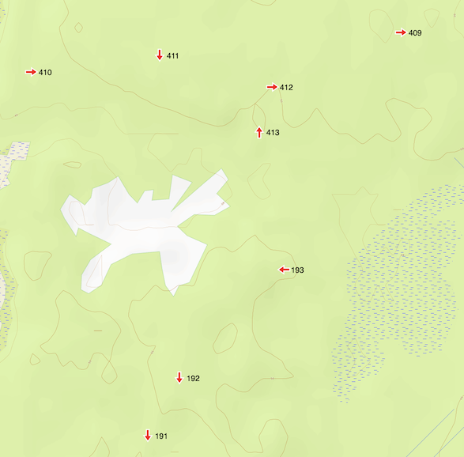

Охват: **Российская Федерация**.

По данным ПСО «Экстремум», установка указателей в местах, где статистически часто теряются люди, позволяет сократить число таких случаев в природной среде до пяти раз.

Потерявшийся сообщает: «Нашёл табличку, на ней номер и название деревни». Такой ориентир может помочь быстро сузить район поиска. Слой «Стрелки» показывает указатели из [общероссийского проекта «Стрелки»](https://strelki.extremum.org/), предназначенного для повышения безопасности людей в природной среде.

Координаты, номера, надписи и направления поступают из базы проекта. ГИС размещает их поверх выбранной карты, чтобы можно было сопоставить табличку с дорогами, просеками, населёнными пунктами и рабочими объектами поиска.

#### Как найти указатель по сообщению человека

Используйте номер и надпись, которые человек уже сообщил. Сопоставьте их с известным районом и регионом: одного короткого номера может быть недостаточно для уверенного выбора.

Переместите карту к предполагаемому району и введите в строку поиска, например, **`стрелка 143`**. Результаты располагаются с учётом расстояния от центра карты. Это помогает начать проверку с ближайших совпадений, но первое место в списке само по себе не подтверждает, что найден нужный указатель.

Сопоставьте полученные сведения с подписью указателя и окружающей местностью на карте.

По запросу **`стрелка`** без номера система предлагает до десяти ближайших указателей в пределах **300 км от центра карты**. Это удобно для предварительного знакомства с районом, но такой список не является полным перечнем всех установленных табличек.

#### Как читать значки и подписи

На обзорном масштабе видны значки, при приближении появляются номера, а затем — текст указателя. При наведении указателя мыши номер и надпись можно прочитать во всплывающей подсказке.

Нажмите на значок, чтобы открыть карточку на сайте проекта. Карточка относится к сочетанию **региона и номера** — проверяйте оба признака.

Поворот стрелки берётся из направления, записанного в базе. Используются восемь основных направлений: **север, северо-восток, восток, юго-восток, юг, юго-запад, запад и северо-запад**. Поэтому изображение передаёт направление приблизительно, с шагом **45°**.

Если направление в исходных сведениях отсутствует или не распознано, значок всё равно может выглядеть как обычная стрелка. Одна его форма не подтверждает направление выхода — проверяйте надпись и карточку указателя.

#### Направление стрелки и путь по местности

Указатель помогает выбрать направление, но линия от него к населённому пункту не описывает весь маршрут. Дорога может изгибаться, проходить через развилки и обходить препятствия.

Например, надпись на деревню не означает, что к ней можно идти напрямую через лес по направлению значка. Сопоставляйте указатель с существующими дорогами и просеками, рельефом и обстановкой на месте. При телефонном сопровождении уточняйте, видит ли человек продолжение пути и следующие ориентиры.

#### Обновление и исправления

Сервер периодически получает новую выгрузку базы проекта. Между плановыми проверками предусмотрена пауза **3 или 4 часа**, к которой добавляется время загрузки.

При недоступности источника используется ранее сохранённая копия. Открытая вкладка карты также может продолжать показывать уже загруженные сведения: обновление серверной базы не означает немедленной замены значков на каждом устройстве.

Если указатель перенесли, повредили или сняли, изменение появится после исправления исходной базы и последующих обновлений. Наличие значка поэтому не подтверждает сохранность таблички на сегодняшний день.

Добавлять и уточнять сведения следует через [сайт проекта «Стрелки»](https://strelki.extremum.org/) с участием ответственных за свой регион. ГИС использует эту базу как источник; перемещение пользовательской метки на вашей карте не исправляет координаты указателя в проекте.

### Трекеры
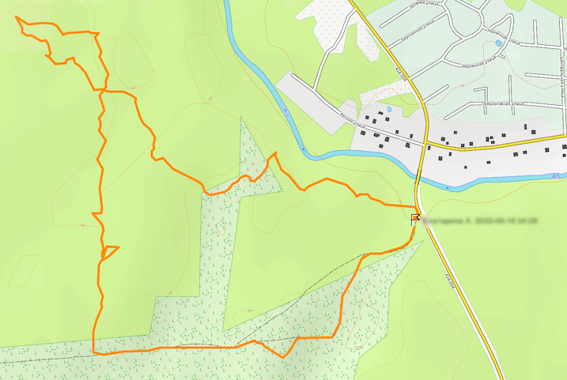

Горячая клавиша: **T**.

Группа движется по лесу, а штаб видит её последнюю переданную точку и пройденный маршрут. Слой «Трекеры» помогает сопоставлять движение групп с задачами, дорогами, препятствиями и другими участниками поиска.

Подключение устройств и приложений описано в разделе [«Онлайн-трекинг»](/online-tracking.html). Для просмотра включите слой и приблизьте район: данные отображаются начиная примерно с масштаба **9**.

#### Последняя точка — это последнее известное положение

Значок ставится в последнюю полученную точку с учётом времени координаты. Если новые сведения перестали поступать, он остаётся на прежнем месте. Это не означает, что группа остановилась: причиной могут быть отсутствие связи, разрядившийся телефон или остановленная запись.

На крупных масштабах рядом с именем появляется местное время координаты — для часового пояса её положения. При наведении можно увидеть давность точки, источник данных, а при наличии сведений — заряд батареи и оценку точности.

Например, если значок находится у развилки, а последняя точка получена двадцать минут назад, на карте показана эта развилка как последнее известное положение. Куда группа успела пройти дальше, нужно уточнять по связи.

#### Круг, стрелка и окружность точности

**Стрелка** передаёт курс из свежих данных: для её отображения используется точка не старше **пяти минут**. Она поворачивается вместе с картой, сохраняя направление на местности.

**Круг с первой буквой имени** используется, когда отображаемого направления нет или точка уже недостаточно свежая для стрелки. Круг сам по себе не означает стоянку группы.

Если источник передал оценку точности, вокруг значка появляется дополнительная окружность. Её размер связан с указанной погрешностью в метрах. Это помогает отличать уверенно определённую точку от приблизительной, но не гарантирует, что человек обязательно находится внутри нарисованной границы.

Оценку точности сообщает источник. Большая окружность или резкие скачки координат — повод осторожнее сопоставлять трек с узкими тропами, берегами и отдельными зданиями.

#### Почему линия трека отличается от исходных точек

Даже неподвижный телефон может записывать немного разные координаты. Если соединить все такие точки, вокруг места стоянки получится клубок линий, похожий на настоящее движение.

Для отображения используется **адаптивная фильтрация**. Она убирает повторяющиеся координаты, часть перемещений в пределах заявленной погрешности и точки с необычно плохой точностью. Настройка опирается на **медианные значения** интервалов между точками и их погрешностей: медиана характеризует середину ряда и меньше зависит от отдельных крайних значений.

При больших перерывах или скачках расстояния маршрут разделяется на сегменты. Допустимый перерыв подстраивается под обычную частоту поступления точек и ограничивается диапазоном от **пяти минут до часа**. Поэтому разрыв линии может означать перерыв в данных, а не завершение движения.

Фильтрация делает маршрут удобнее для чтения, но не восстанавливает путь там, где координат нет. Прямая между двумя сохранившимися точками также не доказывает, что группа прошла именно по этой прямой.

#### Обновление и побледневшие треки

При включённом слое карта регулярно запрашивает новые сведения — примерно раз в **10 секунд**. Это частота проверки карты, а не обязательная частота передачи каждого трекера: устройства и приложения отправляют координаты со своими интервалами.

Запросы приостанавливаются, когда вкладка скрыта, а также после длительного отсутствия действий: примерно **30 минут** для вошедшего пользователя и **10 минут** без входа. Возвращение во вкладку или работа с картой позволяют возобновить обновление.

При ошибке очередной загрузки ранее полученные треки могут оставаться на экране и отображаться бледнее. Побледнение сообщает о проблеме обновления карты; давность конкретной координаты нужно смотреть отдельно. После успешного получения данных обычная яркость восстанавливается.

#### Как сохранить маршрут

Нажмите на значок трекера, чтобы открыть сведения и ссылки скачивания **GPX**:

- **«Отфильтрованный, как трек отображается»** — маршрут после обработки, удобный для дальнейшей работы с картой.
- **«С исходными данными»** — сохранённые точки без этой фильтрации, включая повторы и возможный шум. Такой файл полезен для подробного разбора записи.

Основное хранилище трекеров рассчитано на **24 часа**. Если маршрут нужен для отчёта или последующего анализа, сохраните его своевременно. Онлайн-слой помогает следить за текущей работой, а длительное хранение материалов поиска нужно организовать отдельно.

### Слои геолокации

Потерявшийся открыл присланную ссылку и разрешил определение местоположения. На карте начинают появляться координаты его устройства. Слои геолокации помогают рассмотреть эти результаты вместе с дорогами, водоёмами, рельефом и другими сведениями о районе.

| Слой | Доступ к просмотру |
|:---|:---|
| **Сервис геолокации** | Публичные данные, доступны без входа |
| **Геолокация LizaAlert** | Требуются вход и разрешённый доступ |
| **Геолокация Экстремум** | Требуется учётная запись с доступом Экстремум; её связь с базой организации должна быть настроена |

Выбирайте слой, соответствующий сервису, ссылку на который получил человек. Порядок работы со ссылками, разрешениями и диагностикой описан в разделе [«Геолокация в подробностях»](/gps-monitoring.html).

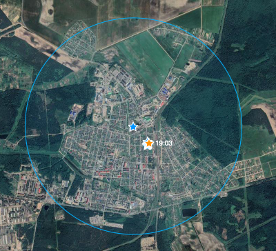

#### Что означают звёзды

**Оранжевая звезда** выделяет последнюю принятую координату устройства в выбранном сервисе. **Синие звёзды** показывают предыдущие результаты.

Цвет обозначает порядок поступления данных, а не их качество. Например, сначала могла прийти точка с оценкой точности **20 м**, а затем — с оценкой **500 м**. Оранжевой станет вторая, хотя первая была точнее по оценке устройства.

Поэтому при работе смотрите одновременно на положение звёзд, их последовательность и указанную точность. Новая звезда в стороне от предыдущих не всегда означает перемещение человека: мог измениться способ определения координат или ухудшиться приём.

#### Почему координаты уточняются и иногда «прыгают»

Браузер получает местоположение через **Geolocation API** — стандартный механизм обращения к службам геолокации устройства. Система телефона может использовать спутниковую навигацию, сведения о сетях Wi-Fi и сотовой связи и другие доступные данные.

Сервис делает несколько запросов с разными требованиями к точности и допустимой давности результата. Это позволяет сначала получить хотя бы приблизительное положение, а затем попытаться его уточнить.

Представьте, что сначала человек смог назвать только район, а позже — конкретную развилку. Первые и последующие ответы имеют разную подробность, но при этом уточнение не обязано идти строго от худшего к лучшему. У телефона также могут чередоваться более и менее точные результаты.

Часть первых ответов может быть взята из сохранённых координат устройства. Поэтому быстро появившаяся звезда ещё не подтверждает, что телефон только что выполнил новое спутниковое измерение.

#### Как понимать радиус точности

Величина **± N м** поступает от устройства вместе с координатой. Окружность вокруг звезды помогает увидеть масштаб этой неопределённости.

Для браузерного определения координат [спецификация W3C](https://www.w3.org/TR/geolocation/) задаёт показатель точности с **95-процентным уровнем доверия**. Это характеристика оценки, которую должен передавать браузер, а не проверенная ГИС гарантия нахождения человека внутри окружности.

Например, оценка **± 100 м** не означает, что человек находится ровно в ста метрах от звезды или обязательно на ближайшей дороге. Центр — расчётная координата; радиус сообщает, насколько неопределённым устройство считает результат.

Повторяющиеся близкие точки с небольшой заявленной погрешностью помогают увереннее сопоставлять положение с местностью. Однако несколько совпавших результатов не становятся независимыми подтверждениями автоматически: устройство могло повторно использовать одну сохранённую координату или один и тот же источник.

#### Какое время показано

Временные метки сохраняемых результатов относятся к **приёму сообщения сервисом**. Если браузер передал ранее сохранённую координату, недавнее время получения не делает само измерение новым.

На очень крупном масштабе возле предыдущих точек появляются короткие подписи времени. В текущем интерфейсе они форматируются в **часовом поясе устройства, на котором открыта карта**. При работе с другим регионом учитывайте разницу часовых поясов.

#### Обновление и исчезновение точек

При включённом слое карта получает уведомления о новых данных и периодически проверяет обновления — примерно раз в **15 секунд**. Это частота проверки карты, а не обещание получать новую координату телефона с таким интервалом.

Обновление приостанавливается в скрытой вкладке и после длительного отсутствия действий: примерно через **60 минут** для вошедшего пользователя и **15 минут** без входа. После возвращения к работе карта возобновляет получение сведений и запрашивает актуальные данные.

В выдачу входят результаты за последние **24 часа по времени приёма**. Старые точки исключаются по мере истечения этого срока; на открытой карте изменение становится видно после обновления. Исчезновение точки через сутки не означает, что человек покинул район или завершил работу с сервисом.

> ##### Предупреждение
> Пожалуйста, используйте сервисы геолокации только по назначению. «Экспериментировать» с ними не стоит, даже если вы убеждены, что вам очень надо, и ничего не случится, если пару раз вы туда сходите. Простота входа в них необходима для того, чтобы пострадавшие могли легко туда попасть по ссылке, отправленной спасателями. Помните, что в случае, если вы будете использовать сервисы определения координат в тренировочных целях в сезон (с мая по октябрь включительно), есть существенный риск, что вас заблокируют всем провайдером или регионом в самый неожиданный момент.
{: .block-danger }

### Ветер, дождевые облака
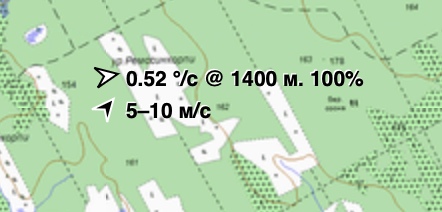

Горячая клавиша: **E**

На данном слое для каждого сегмента карты отображаются:
- направление движения облаков (градусы в секунду) и их высота,
- направление и скорость ветра.

Направление смещения облаков и их угловая скорость (°/с) рассчитываются по ветру на **нижней границе облачности** — именно этот облачный ярус наблюдатель с земли видит непосредственно над собой. По данным модели **ECMWF** высота нижней границы облаков задаётся относительно поверхности земли (то есть на той высоте над землёй, которую видит наблюдатель), тогда как высотные поля ветра в атмосфере моделируются на высотных уровнях атмосферного давления относительно уровня моря. Чтобы точно определить скорость и направление дрейфа облачности — особенно на возвышенностях, холмистых грядах, плоскогорьях и в горной местности — система учитывает сглаженную высоту рельефа местности по цифровой модели высот **FABDEM** и интерполирует вектор высотного ветра между охватывающими атмосферными уровнями, соответствующими истинной высоте основания облаков над уровнем моря.

Для ориентирования потерявшегося в природной среде (при выводе на линейный ориентир или к ближайшему жилью) по движению облаков используются практические пороги визуального восприятия:
- **≥ 0,3 °/с** — направление движения облаков надёжно различимо человеком с земли невооружённым глазом (можно уверенно давать указания по направлению смещения облачности);
- **0,25 °/с** — пограничный порог: часть людей уверенно определяет направление смещения облаков, тогда как другим требуется длительное наблюдение или они испытывают затруднения;
- **≤ 0,2 °/с** — смещение облаков слишком медленное для зрительного восприятия человека, ориентировать потерявшегося по облакам невозможно (движущиеся тени от облаков на карте автоматически отключаются при скорости ниже 0,2 °/с).

> ##### Сопоставление старых и обновлённых порогов угловой скорости облаков
> Алгоритм расчёта угловой скорости движения облаков был уточнён: вместо приближения через арксинус со ступенчатым округлением высоты облачности строго вниз до сотен метров теперь используется точная тригонометрическая геометрия (тангенс) с билинейной интерполяцией ветра и привязкой к ближайшей сотне метров высоты нижней границы облаков.
> 
> Как соотносятся прежние эмпирические значения с обновлённым расчётом:
> - **При средней и высокой облачности (800–2000 м):** практические пороговые ориентиры `0,20 / 0,25 / 0,30 °/с` практически не изменились и полностью совпадают со старыми оценками.
> - **При очень низкой облачности (200–400 м):** старый расчёт систематически занижал высоту облачной базы до меньшей сотни метров, что искусственно завышало отображаемую угловую скорость примерно на 15–30%. В результате прежнее значение `0,30 °/с` под низкой облачностью соответствует примерно `0,23–0,26 °/с` в обновлённом расчёте, а прежнее значение `0,25 °/с` — примерно `0,20–0,22 °/с`.

#### Спутниковая облачность на обзорных масштабах и тени от облаков на крупных масштабах
При включённом слое текущей погоды отображение облачности автоматически адаптируется к выбранному масштабу карты, переходя от реальной космической съёмки облачного покрова на обзорных и региональных масштабах к локальной проекции движущихся теней от облаков на рельеф местности при приближении к району поиска.

##### Спутниковая облачность на обзорных масштабах (до масштаба 12)
На мелких и средних масштабах (до масштаба 12) поверх карты отображается фактический облачный покров по данным глобальной группировки геостационарных метеорологических спутников (**EUMETSAT Meteosat**, **NOAA GOES**, **JMA Himawari**). Эти аппараты обращаются в плоскости экватора на высоте около 35 786 км со скоростью вращения Земли, поэтому непрерывно «зависают» над одними и теми же полушариями и сканируют полный диск планеты каждые 10 минут — существенно чаще, чем пересчитываются глобальные гидродинамические модели прогноза погоды.

При включённом слое текущей погоды карта автоматически запрашивает обновление спутниковой облачности каждые **5 минут**, пока вкладка с картой видима. Если слой выключен или вкладка скрыта, запросы приостанавливаются. После возвращения к карте с включённым слоем обновление произойдёт при следующем пятиминутном запросе — перезагружать страницу вручную не нужно. Этот интервал относится к обновлению карты, а не к частоте спутниковой съёмки: изображение облаков изменится, когда станут доступны новые данные.

Чтобы облачность выглядела естественно и оставалась информативной в любое время суток — днём, ночью и в полосе сумерек (на границе дня и ночи), — изображение на карте формируется сразу из двух независимых спектральных каналов спутниковой съёмки:
- **Видимый канал (*VIS*, яркость отражённого солнечного света)** фиксирует долю солнечного света, отражённого верхней границей облаков. Плотные кучево-дождевые, слоисто-кучевые облака и низкие приземные туманы ярко отражают солнечные лучи, тогда как тонкая дымка остаётся полупрозрачной. В ночные часы солнечная подсветка отсутствует, и видимый канал сам по себе «слепнет».
- **Тепловой инфракрасный канал (*IR*, яркостная температура в окне прозрачности атмосферы около 10,8 мкм)** измеряет собственное тепловое излучение вершин облаков в диапазоне температур примерно от 183 до 321 К (от −90 °C до +48 °C). Поскольку температура тропосферы падает с высотой в среднем на 6,5 °C на каждый километр, тепловой датчик спутника фактически работает как космический высотомер облачности: чем выше в тропосферу поднялась вершина облака, тем она холоднее. Этот канал видит облака круглосуточно, однако низкие тёплые слоистые облака и туманы по температуре почти сливаются с подстилающей земной поверхностью.

Совмещение каналов **VIS** и **IR** позволяет объединить сильные стороны обоих физических диапазонов:
- **Круглосуточный обзор и естественный переход через сумерки:** на освещённой Солнцем стороне Земли детализация облаков опирается на реальную солнечную отражательную способность (**VIS**) в сочетании с высотным профилем (**IR**), благодаря чему отчётливо видны даже низкие тёплые облака и утренние туманы. На ночной стороне изображение плавно переходит на тепловой инфракрасный канал (**IR**). Поскольку освещённость каждого пикселя заложена непосредственно в данных самого спутникового снимка, яркость и оттенок облаков остаются неизменными при перемещении карты через разные часовые пояса и широты.
- **Объёмный рельеф облачных вершин:** по перепадам температуры и яркости соседних участков облачности рассчитывается направленное рельефное затенение (с классической картографической северо-западной подсветкой). Благодаря этому плотные мощные кучево-дождевые шапки и фронтальные гряды приобретают наглядный трёхмерный объём и легко отличаются от тонкой полупрозрачной перистой пелены верхнего яруса.

При приближении карты от масштаба 7 к масштабу 12 обзорный спутниковый слой плавно становится прозрачным, постепенно открывая детальную картину местности и уступая место расчётным теням от облаков.

##### Движущиеся тени от облаков на крупных масштабах (от масштаба 12 и крупнее)
При включённом слое текущей погоды на масштабах от 12 и крупнее в дополнение к стрелке движения облаков у края экрана со стороны Солнца (а ночью — со стороны Луны, если она находится над горизонтом) отображаются движущиеся тени от облаков с учётом рельефа местности (**FABDEM**). Направление, скорость и плотность теней соответствуют фактическому направлению смещения облачности, её угловой скорости (°/с) и проценту облачного покрова, что позволяет наглядно оценить, куда и насколько заметно для наблюдателя с земли плывут облака — например, при ориентировании потерявшегося по движению туч или положению светила.

Тени показываются только тогда, когда движение облаков достаточно заметно с земли (угловая скорость не менее 0,2°/с при известной высоте нижней границы облачности) и над горизонтом есть Солнце или Луна. При безоблачной погоде, слишком медленном смещении облаков, на мелких масштабах карты, при выборе других вариантов погодного слоя, а также если в настройках операционной системы или браузера включён режим уменьшения движения (анимации), движущиеся тени автоматически скрываются (при этом статичная спутниковая облачность на мелких масштабах остаётся доступной независимо от настройки уменьшения анимации).

> ##### Практическое замечание для поиска (ПСР)
> Сочетание обзорной спутниковой облачности и крупномасштабных теней позволяет оценивать метеообстановку на двух уровнях:
> - **На региональном масштабе (до масштаба 12)** по фактическим спутниковым снимкам (обновляемым каждые 10 минут) видно реальное расположение облачных фронтов, гряд и просветов («окон» ясного неба) вокруг района ПСР. Это помогает заранее понять, приближается ли к району поиска сплошная облачная масса или, наоборот, подходит полоса прояснения, когда у потерявшегося появится возможность увидеть Солнце, Луну или высотные конденсационные следы самолётов.
> - **На масштабе района поиска (12 и крупнее)** на первое место выходит задача непосредственного вывода и ориентирования человека с земли: карта освобождается от сплошной облачной пелены, открывая детальную топографию и космоснимки местности, а полоса движущихся теней у края экрана и стрелка ветра на высоте облаков показывают, сможет ли потерявшийся визуально заметить движение туч на небе.

##### Осадки у края карты (от масштаба 14 и крупнее)

При включённом слое текущей погоды на масштабе **14 и крупнее** у края карты появляются падающие капли, снежинки или ледяные частицы. Используются погодные данные для **центра карты**. Осадки видны с той стороны, откуда дует приземный ветер; при повороте карты эта сторона меняется вместе с направлением ветра. Частицы уменьшаются и исчезают, словно удаляясь к земле, а узкая область анимации оставляет большую часть карты открытой.

Дождь показан быстрыми вытянутыми каплями, снег — медленно падающими снежинками, мокрый снег — преимущественно округлыми хлопьями. Дождь со снегом и смешанные ледяные осадки объединяют несколько видов частиц; град показан компактными ледяными частицами. Ледяной дождь остаётся каплями: анимация не показывает обледенение поверхности. При грозовых типах осадков отображается дождь **без вспышек молний**. Пропорции частиц в смесях условные и не означают измеренную долю воды, снега или льда.

Чем больше количество осадков за три часа, тем плотнее анимация. У неё есть предел плотности для сохранения быстродействия: два сильных ливня могут выглядеть одинаково. Цвет капель подстраивается под подложку. Для оценки интенсивности используйте также числовые погодные данные; анимация не измеряет видимость и условия непосредственно на земле.

Температура и влажность немного меняют размер, скорость и форму снежинок, а порывы ветра — их снос. Это условные зрительные подсказки, а не прогноз формы кристаллов. При отсутствии подходящих данных температуры или влажности используется базовый вид снега. Если скорость приземного ветра неизвестна, используется скорость порывов; если неизвестны обе, ветровой снос отсутствует. Без направления ветра, распознанного типа или положительного количества осадков эффект скрывается, как и на время обновления погодной точки и после неудачного запроса. Отсутствие анимации само по себе не означает отсутствие осадков.

Анимация отключается при выключении текущей погоды, переходе к другим вариантам погодного слоя, уменьшении масштаба ниже 14 и скрытии вкладки. Если в режиме энергосбережения, при отключённых системных анимациях или работе через удалённый рабочий стол устройство передаёт браузеру настройку ограничения анимации, осадки также скрываются. То же происходит при включённой настройке специальных возможностей «Уменьшение движения» (Reduced Motion). Поведение зависит от устройства, операционной системы и браузера: сам по себе режим энергосбережения или удалённое подключение не всегда отключает этот эффект. Отдельных регуляторов размера, скорости и плотности в погодном слое нет.

Для зрительной настройки снега используется оценка температуры смоченного термометра по [формуле Stull (2011)](https://doi.org/10.1175/JAMC-D-11-0143.1): она учитывает охлаждение при испарении и рассчитана для давления на уровне моря, температур от −20 до +50 °C и влажности 5–99%, с ограничениями для холодного сухого воздуха. Визуализация не вводит поправку на давление; влажность 99–100% рассчитывается как 99%, а сочетание температуры ниже −10 °C и влажности ниже 20% возвращает базовый вид снега. Последний порог — защитное ограничение приложения. [Исследование Li, Guala и Hong (2024)](https://arxiv.org/abs/2406.08737) показывает связь движения снега с формой, ориентацией частиц и движением воздуха. Выбранные в карте размеры, скорости и пропорции — визуальная настройка, а не расчёт по этому исследованию.

### Электрички, самолёты, молнии
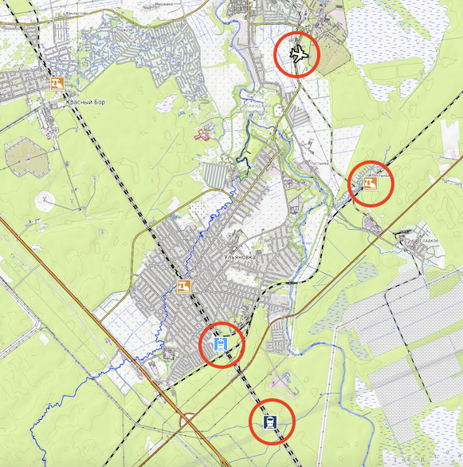

Горячая клавиша: **L**

При наведении на соответствующую иконку на карте отображается:
- для самолета — номер борта и высота, а также конденсационный след (при подходящих атмосферных условиях);
- для поездов — номер пригородного или междугороднего поезда (при нажатии в новом окне откроется сервис «Яндекс Расписания»);
- для железнодорожных станций — название (при нажатии в новом окне откроется сервис «Яндекс Расписания»);
- для искусственных спутников Земли — название спутника, текущая высота орбиты и скорость движения относительно поверхности Земли.

#### Положение поездов и электричек
В отличие от самолётов, передающих свои координаты в реальном времени по радиоканалу, пригородные электрички и поезда дальнего следования не транслируют открытую GPS-телеметрию. Их положение на карте **рассчитывается по расписанию** сервиса «Яндекс Расписания» и **геометрии железнодорожных путей** на карте.

Между соседними станциями, где у поезда предусмотрена остановка, система прокладывает маршрут по железнодорожным путям и распределяет время движения пропорционально длине каждого участка пути между временем отправления от предыдущей станции и временем прибытия на следующую. На время стоянки по расписанию значок поезда остаётся на станции, а в пути его положение на экране плавно обновляется каждые полсекунды.

**Ограничения, которые важно учитывать при работе на ПСР:**
- **Расписание, а не фактический GPS-трек:** если поезд опаздывает, идёт с опережением графика или совершает внеплановую техническую стоянку, на карте он всё равно будет отображаться строго по расписанию.
- **Нет грузовых и служебных поездов:** в расписании присутствуют только пассажирские и пригородные поезда. Товарные составы, маневровые тепловозы и ремонтная техника на карте не отображаются — поэтому звук поезда, который слышит потерявшийся в лесу при пустой карте, может принадлежать грузовому составу или опаздывающему пассажирскому поезду.
- **Равномерная скорость на перегоне:** между двумя остановками скорость считается постоянной вдоль пути без учёта разгона при отправлении, торможения перед станцией и локальных ограничений скорости. Если поезд проследует промежуточные платформы без остановки, время их прохождения интерполируется по расстоянию между ближайшими станциями с остановкой.
- **Упрощение маршрута и первичная загрузка района:** если в картографических данных на перегоне не хватает связного участка железной дороги или расчётная скорость по найденной ветке оказывается неправдоподобно высокой, движение на этом сегменте строится по прямой между станциями. При первом открытии нового района на карте загрузка расписаний по станциям занимает некоторое время — поезда появляются на карте постепенно по мере готовности данных.

#### Конденсационные следы самолётов
Координаты и высоты воздушных судов поступают в реальном времени от сети наземных приёмников сигналов бортовых транспондеров ADS-B. Для барометрической высоты полёта каждого борта температура воздуха, точка росы (влажность) и вектор высотного ветра интерполируются между охватывающими эшелон высотными уровнями атмосферного давления модели **ECMWF** с учётом вертикального профиля атмосферы над рельефом местности.

Конденсационные следы образуются только на больших высотах, где температура окружающего воздуха достаточно низкая (около −40 °C и ниже), чтобы водяной пар от реактивных двигателей замерзал в ледяные кристаллы.

После образования след не остаётся неподвижным вдоль линии маршрута самолёта, а начинает смещаться вместе с воздушной массой на высоте эшелона. Для каждой точки траектории система рассчитывает снос по направлению и скорости высотного ветра пропорционально времени, прошедшему с момента пролёта самолёта через эту точку: свежий участок непосредственно за бортом почти совпадает с текущим курсом, а более старые участки шлейфа при сильном ветре на высоте (особенно в высотных струйных течениях) за несколько минут могут сдвинуться в сторону на многие километры и развернуться под углом к курсу борта. Благодаря этому на карте отображается не пройденный маршрут самолёта, а фактическое положение видимого с земли шлейфа в небе над местностью в текущий момент.

В зависимости от влажности воздуха относительно льда на высоте полёта и времени жизни следа на карте визуально различаются три типа следов:
- **Короткий след** — воздух на эшелоне достаточно холодный для конденсации, но сухой. Образовавшиеся кристаллики льда быстро испаряются (вымерзают в сухом воздухе), и за самолётом виден лишь короткий быстро тающий шлейф.
- **Устойчивый след** — воздух на высоте полёта насыщен влагой относительно льда. Плотная, чёткая белая полоса сохраняется в небе на десятки километров вдоль траектории полёта.
- **Расплывающийся след** — в пересыщенном льдом воздухе по мере старения устойчивого следа и его сноса высотным ветром кристаллы льда продолжают расти, а след постепенно превращается в широкую перистую полосу облачности.

> ##### Практическое замечание для поиска (ПСР)
> В ясную или малооблачную погоду высотные устойчивые и расплывающиеся конденсационные следы (как и сами самолёты) отлично видны с земли на удалении в десятки километров. Спасатель может использовать видимый след или пролетающий борт как дополнительный естественный ориентир при телефонном опросе потерявшегося для уточнения направления его взгляда и азимута движения.

### Солнце и Луна
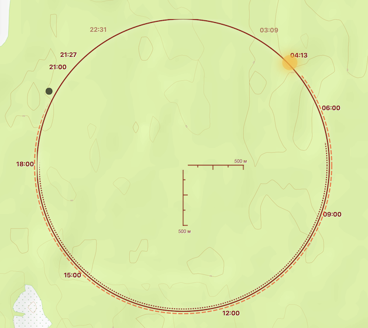

Горячая клавиша: **K**

При телефонном опросе потерявшийся иногда хорошо видит Солнце, но не может назвать направление на ближайшую дорогу. Калькулятор помогает сопоставить положение светила с картой: уточнить, в какую сторону смотрит человек, и оценить, сколько осталось до заката или окончания сумерек.

Расчёт выполняется для **центра карты**, на текущую дату и время. Поэтому сначала переместите карту к предполагаемому району нахождения человека. Координаты вашего компьютера или телефона для этого расчёта не используются.

#### Как читать положение светил

Представьте, что смотрите на небо сверху, а наблюдатель находится в центре окружности. Направление от центра к значку Солнца или Луны показывает, в какой стороне находится светило. Чем выше оно над горизонтом, тем ближе его значок к центру. Расстояние до значка передаёт высоту на небе, а не расстояние до самого небесного тела.

При повороте карты изображение поворачивается вместе с ней, сохраняя связь с направлениями на местности. Например, если линия от предполагаемого положения потерявшегося к Солнцу пересекает дорогу, можно уточнить, видит ли человек Солнце в стороне этой дороги. Само по себе такое наблюдение задаёт направление, но не определяет координаты.

Когда круговой калькулятор свёрнут, у края карты остаётся указатель направления на Солнце. Для просмотра Луны, времени восхода, заката и сумерек разверните калькулятор.

#### Откуда берётся положение Солнца и Луны

Положение светил вычисляется по астрономическим формулам: учитываются движение Земли и Луны, вращение Земли, дата, время и положение наблюдателя. Затем небесные координаты переводятся в два понятных направления: **азимут** — куда смотреть вдоль горизонта — и **высоту** — насколько поднять взгляд. Принцип солнечного расчёта разобран в [Astronomy Answers](https://aa.quae.nl/en/reken/zonpositie.html).

Это позволяет рассчитать положение светила независимо от того, видно ли его сейчас за облаками. Часы устройства должны показывать правильную дату и время: ошибка часов смещает и расчётное положение.

Яркость значка Луны зависит от доли её освещённой части. Очень тонкий серп и Луна ниже примерно **3° над горизонтом** не отображаются: для появления значка требуется освещённость более **5%** и достаточная высота. Поэтому отсутствие значка не всегда означает, что Луна уже зашла.

#### Восход, закат и сумерки

Пунктирная дуга снаружи окружности показывает направления на Солнце от восхода до заката. Часовые подписи расположены по направлению на Солнце в соответствующее время. Это не обычный циферблат: расположение подписей зависит от даты и места наблюдения.

Дополнительно подписаны начало утренних и окончание вечерних **гражданских сумерек**. После заката Солнце уже скрыто, но ещё освещает верхние слои атмосферы, и рассеянный свет достигает земли. Вечерние гражданские сумерки заканчиваются, когда центр Солнца опускается на **6° ниже горизонта**; утром тот же порог обозначает их начало. [Подробнее о сумерках — NOAA](https://www.weather.gov/fsd/twilight).

Эти времена помогают оценить оставшуюся светлую часть суток. Под плотными кронами, в глубокой ложбине или при сильной облачности темнеет раньше, чем на открытой местности. Окончание гражданских сумерек — астрономический ориентир, а не гарантированное время, до которого группе будет достаточно естественного света.

В высоких широтах некоторые подписи могут отсутствовать: в полярный день Солнце не заходит, а в полярную ночь не восходит.

#### Какое время указано

Время событий показывается для часового пояса **района в центре карты**. Если он отличается от часового пояса устройства, появляется разница со знаком «плюс» или «минус». На широком экране рядом показывается также текущее время района; на узком — только разница.

Например, **+03:00** означает, что в районе на три часа больше, чем на вашем устройстве. Если у вас 13:00, там 16:00. Разница отсчитывается от настроенного времени устройства; московское время служит отправной точкой только тогда, когда устройство само работает по нему.

#### Почему светило на карте может быть не видно с земли

Расчёт использует условный открытый горизонт. Гора, здания или деревья могут закрывать Солнце и Луну, даже когда их значки находятся над горизонтом. Облака также могут полностью скрыть светило.

Например, в узкой долине Солнце уйдёт за склон раньше расчётного заката. Поэтому при работе по телефону сначала уточните, действительно ли человек видит само светило, затем сопоставляйте его положение с картой.

### Пожары

Горячая клавиша: **F**.

Варианты: **Авто / Точками / За 14 дн**.

Летом и осенью дым в районе поиска может приходить издалека, а может означать действующий лесной или травяной пожар прямо на маршруте группы. Слой «Пожары» помогает оценить обстановку за последние сутки и увидеть недавно выгоревшие участки за две недели.

#### Откуда поступают данные

Тепловые аномалии за последние **24 часа** поступают со спутниковых радиометров **MODIS** (аппараты *Terra* и *Aqua*, номинальное разрешение в надире около **1 км**) и **VIIRS** (аппараты *NOAA-20* и *NOAA-21*, разрешение около **375 м**). Датчики фиксируют инфракрасное излучение земной поверхности и выделяют участки, температура которых заметно превышает окружающий фон, оценивая **тепловую мощность очага** (**FRP**, *Fire Radiative Power*) в мегаваттах (**МВт**). Алгоритм обнаружения активного горения VIIRS описан в [работе Schroeder и соавторов, 2014](https://doi.org/10.1016/j.rse.2013.12.008).

Спутник фиксирует тепловое пятно на момент своего пролёта, а не ведёт непрерывную видеосъёмку. Если к моменту пролёта очаг был закрыт плотной облачностью, он может не попасть в выборку. Когда ожидается следующий пролёт и сколько времени занимает приём данных со спутника, показывает сводка в левом нижнем углу экрана (подробнее — в разделе [«Сводка свежести снимков и времени пролёта»](#сводка-свежести-снимков-и-времени-пролёта-в-левом-нижнем-углу)).

Сервер запрашивает обновлённые спутниковые выборки каждые **20–40 минут**, а открытая карта проверяет обновления раз в час.

#### Как работают варианты слоя

- **«Авто»** (доступен с масштаба **7**): на обзорных масштабах (**7–11**) показывает отдельные тепловые точки, а при приближении к району поиска (**с масштаба 11 и крупнее**) переходит к **контурам зон горения**, построенным с учётом размера спутникового пикселя и времени обнаружения.
- **«Точками»** (масштабы **7–11**): отображает отдельные срабатывания тепловых датчиков. Размер значка растёт с тепловой мощностью очага (от 1 до 250 МВт), а цвет помогает сразу отличить природный пожар от антропогенной засветки:
  - **Красный** — лесной массив вдали от ночного освещения населённых пунктов.
  - **Оранжевый** — открытые природные пространства (луга, кустарник, тундра) без искусственной засветки.
  - **Коричневый** — сельхозугодья, посадки или растительность вблизи слабого искусственного освещения.
  - **Жёлтый** — территория застройки, промышленная площадка с ярким ночным освещением (по данным **VIIRS**) или поверхность без растительности.
- **«За 14 дн»** (масштабы **7–24**): показывает выгоревшие площади за последние две недели по данным снимков **Sentinel-2** с помощью **индекса выгоревшей площади BAI** (*Burned Area Index*, [Chuvieco и соавторы, 2002](https://doi.org/10.1080/01431160210153129)). Более свежие гари выделяются красно-оранжевыми оттенками, более старые — приглушёнными оранжевыми.

В режиме **«Авто»** на крупных масштабах зоны горения за последние сутки делятся по давности на шесть четырёхчасовых интервалов: самые свежие контуры отображаются ярче и плотнее, а очаги давностью **20–24 часа** — более прозрачной линией с пунктирным контуром.

При наведении курсора на точку или контур подсказка показывает время обнаружения, сколько часов прошло с момента пролёта, тепловую мощность в **МВт**, расчётную **опасность распространения огня** от 1 до 10 (по метеорологическому индексу **FWI** модели **Intersucho**), а для точек — также тип поверхности, породу и высоту леса, год потери крон и долю ночной освещённости.

#### Как отсеиваются постоянные техногенные источники тепла

Инфракрасные датчики спутников реагируют на любое сильное тепло: кроме лесных и травяных пожаров в сырые спутниковые данные постоянно попадают газовые факелы нефтепромыслов, металлургические печи, цементные заводы, ТЭЦ и горящие свалки. Если показывать их наравне с природными очагами, в промышленных районах карта окажется засыпана ложными «пожарами».

Чтобы убрать постоянный техногенный фон, система сопоставляет архивные спутниковые наблюдения за **три последовательных квартала** (9 месяцев). Если в одном и том же месте (с поправкой на размер спутникового пятна) тепловая точка регулярно появлялась во всех трёх кварталах подряд, объект заносится в каталог постоянных тепловых источников, а для него рассчитываются типичная средняя мощность излучения (**FRP**) и её обычный разброс (стандартное отклонение $\sigma$).

Обычные срабатывания в таких точках автоматически скрываются с карты. Однако в месте постоянной тепловой активности — например, на территории предприятия, свалки или участка регулярного сжигания порубочных остатков — может начаться настоящий крупный пожар. Поэтому система проверяет текущую мощность каждого очага: если измеренная мощность **FRP** сильно превышает историческую норму для этой точки (одновременно выше порога $\mu + 3\sigma$, не менее чем в **3 раза** выше типичной средней мощности $\mu$ и минимум на **15 МВт** выше неё), подавление отключается, и очаг отображается на карте как действующий пожар.
