Создание объектов осуществляется через панель инструментов в левой части экрана, редактирование и управление - через контекстные меню и основное меню ГИС соответственно.

Цвет при создании любого объекта выбирается случайно из семи возможных, в дальнейшем его можно изменить.

Во время рисования объектов действуют следующие горячие клавиши:
- Enter - при рисовании линий или полигонов позволяет зафиксировать текущую фигуру и завершить рисование,
- Del или Backspace - при рисовании линий или полигонов позволяет удалить предыдущее изменение фигуры, а при наличии выделенных объектов - удалить их,
- Escape - позволяет отменить рисование линии или полигона,
- зажатый Ctrl позволяет выделить объект(ы) при помощи мыши,
- Ctrl+C/Cmd+C позволяет скопировать в буфер обмена объект(ы) в формате JSON,
- Ctrl+V/Cmd+V позволяет вставить из буфера обмена объект(ы) в формате JSON или координаты.

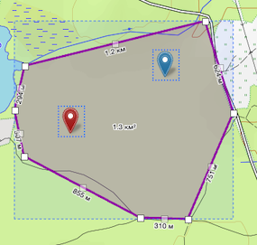

> ##### Быстрое добавление треков на карту 
> Файлы треков можно перетащить из папки прямо в окно браузера или приложения.

## Метки
Меткой называется особым образом обозначенная точка на карте. Свойствами метки являются координаты, цвет и название (опционально).

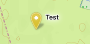

### Создание метки
Создать метку можно двумя способами:
- выбрать на панели инструментов кнопку "Создать метку" и нажать левой кнопкой мыши на карте,

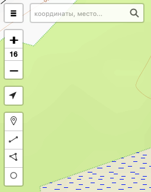

- открыть контекстное меню карты, нажав правой кнопкой мыши в нужном месте, и выбрать пункт **«Создать метку»**.

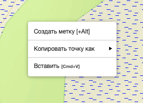

Каждой метке можно назначить имя (не обязательно уникальное).

### Редактирование метки
При открытии контекстного меню метки (по нажатию правой кнопкой мыши по метке) появляются следующие возможности:
- "копировать точку как" с вариантами - ссылка на ГИС для ПСО или Яндекс-карты, координаты в разных форматах, ссылка для Яндекс-навигатора или все предыдущие варианты одновременно,
- "цвет" - позволяет изменить цвет метки,
- "заблокировать" или "изменить" - меняет состояние метки, в заблокированном состоянии метку невозможно передвинуть на карте,
- **«Удалить»** — убирает объект с карты. Удаление можно отменить, пока соответствующее действие доступно в истории текущего окна ГИС.

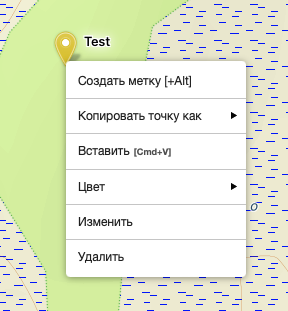

При двойном нажатии левой клавиши мыши на метке (а также двойное нажатие по экрану мобильного устройства, "левый Alt+ЛКМ" для Windows/Linux или "Option+ЛКМ" для MacOS) появляется диалоговое окно с возможностью редактирования названия метки, координат и цвета.

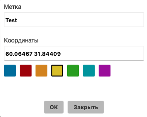

## Линии

Линия позволяет измерить расстояние между точками или нарисовать маршрут из нескольких отрезков. Её можно построить по отдельным точкам или провести одним движением. К дорогам и тропам линия автоматически не привязывается.

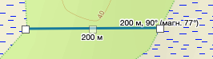

### Построение по точкам

На панели инструментов нажмите **«Нарисовать линию или маршрут»**, затем последовательно отмечайте точки на карте:

1. Первое нажатие задаёт начало.
2. Каждое следующее добавляет точку и соединяет её с предыдущей.
3. Чтобы закончить линию, ещё раз нажмите на последнюю поставленную точку. На компьютере также можно нажать **Enter**.

**Escape** отменяет незавершённую линию. Повторное нажатие **Escape** выключает инструмент рисования.

Готовая линия сохраняется среди пользовательских объектов. Через **«Свойства»** в её контекстном меню можно задать название и изменить цвет.

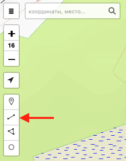

### Линия одним движением: Shift и перо

Для плавного контура можно провести линию непрерывным движением указателя. В этом случае ГИС сама добавляет точки по ходу движения.

При работе **мышью или тачпадом** включите инструмент рисования линии и удерживайте **Shift**. Затем проведите линию обычным для вашего устройства жестом перетаскивания. Удерживайте Shift до конца этого движения. Когда закончите перетаскивание, построение линии завершится.

Например, мышью для этого ведут указатель с нажатой основной кнопкой. На тачпаде используется настроенный на устройстве способ перетаскивания. Значок инструмента при удержании Shift меняется с прямого отрезка на извилистую линию.

Для работы **электронным пером** коснитесь пером кнопки **«Нарисовать линию или маршрут»**. Инструмент сразу включится в режиме непрерывного рисования, без Shift. Проведите пером по карте и поднимите его, чтобы закончить линию.

В этом режиме жест перетаскивания рисует линию вместо перемещения карты. Построение по отдельным точкам удобнее, когда важно явно задать каждый поворот; непрерывное рисование — когда нужно быстро обвести плавный контур.

У линии, проведённой одним движением, не показываются промежуточные длины отрезков и маркеры для редактирования отдельных вершин. Общая длина отображается во время рисования и остаётся доступной в режиме редактирования.

### Как рассчитывается расстояние

При построении и редактировании линии по точкам возле отрезков показываются их длины, а у конца линии — общая длина. Для одного отрезка используется одна итоговая подпись.

Расстояние рассчитывается по географическим координатам на **сферической модели Земли**, с помощью **формулы гаверсинусов**. Она учитывает кривизну поверхности, поэтому результат не получается простым измерением пикселей на экране.

Общая длина складывается из расстояний между последовательными точками. Например, если соединить начало и конец извилистой дороги одним отрезком, измерение спрямит её повороты. Дополнительные точки позволяют приблизить линию к видимой форме дороги.

При непрерывном рисовании точки добавляются автоматически. Поэтому длина зависит от проведённого контура: небольшие колебания указателя тоже могут её увеличивать.

Расчёт не учитывает подъёмы и спуски по рельефу. Он описывает расстояние по поверхности модели Земли, а не длину пути по склонам.

### Направление и магнитная поправка

Для линии из одного отрезка рядом с длиной показывается направление **от первой точки к последней**, отсчитанное по часовой стрелке от севера: **0°** — север, **90°** — восток, **180°** — юг, **270°** — запад.

Угол определяется по направлению отрезка в проекции карты. Для длинных линий он может отличаться от начального направления кратчайшего пути по поверхности Земли.

После получения магнитного склонения может появиться дополнительное значение с пометкой **«магн.»**. Склонение — угол между географическим и магнитным севером; для поправки используются данные NOAA. [Подробнее о магнитном склонении](https://www.ncei.noaa.gov/products/magnetic-declination).

Магнитная поправка загружается отдельно. Поэтому сначала может отображаться только основное направление, а значение **«магн.»** появится позднее. Отсутствие этой подписи само по себе не означает нулевого склонения.

У линии из нескольких отрезков единственного направления нет: итоговая подпись показывает общую длину.

### Редактирование формы

После построения линии по точкам на ней видны маркеры вершин и промежуточные маркеры между ними.

Перетащите вершину, чтобы изменить положение существующей точки. Перетаскивание промежуточного маркера добавляет новую вершину и позволяет сделать дополнительный изгиб. Короткое нажатие на маркер существующей вершины удаляет её.

После изменения формы длины пересчитываются. Изменение, сделанное перетаскиванием, можно отменить через **Ctrl+Z** на Windows/Linux или **Cmd+Z** на macOS, когда ввод не находится в текстовом поле.

Команда **«Заблокировать»** в контекстном меню выключает редактирование и скрывает управляющие маркеры и измерительные подписи. Сама линия остаётся на карте. Чтобы снова включить редактирование, выберите **«Разблокировать»**.

У линии, проведённой одним движением, маркеры отдельных вершин остаются скрытыми и после разблокировки.

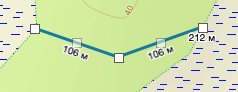

### Название, копирование и сохранение

Откройте контекстное меню линии и подменю объекта. Через **«Свойства»** можно изменить название и цвет.

В том же подменю доступны копирование объекта в **GeoJSON**, копирование названия и координат обычным текстом, ссылка на линию и сохранение в **GPX**.

GeoJSON подходит для переноса линии вместе со свойствами между окнами ГИС. Текстовая запись удобна для просмотра координат, а GPX — для переноса маршрута в программы и устройства, поддерживающие этот формат.

Команда **«Удалить»** убирает линию с карты. Удаление можно отменить, пока соответствующее действие доступно в истории текущего окна ГИС.

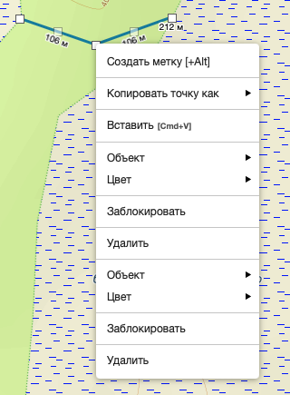

## Полигоны

Полигон обозначает область с замкнутой границей. Им можно очертить участок карты, измерить его площадь, подготовить карту к печати или задать территорию для скачивания карт.

Граница строится по указанным точкам либо рисуется одним движением. К дорогам, берегам и другим объектам подложки она автоматически не привязывается.

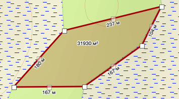

### Построение по точкам

На панели инструментов нажмите **«Нарисовать полигон»**, затем последовательно отмечайте вершины на карте. Для области нужны как минимум три разные точки.

Во время построения ГИС показывает будущий контур, включая замыкающую сторону. Чтобы закончить полигон, нажмите на первую точку. На компьютере также можно нажать **Enter**.

**Escape** отменяет незавершённый полигон. Повторное нажатие **Escape** выключает инструмент рисования.

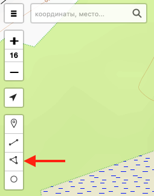

### Контур одним движением: Shift и перо

При работе **мышью или тачпадом** включите инструмент рисования полигона и удерживайте **Shift**. Обведите область обычным для устройства жестом перетаскивания. Удерживайте Shift до конца движения.

Для работы **электронным пером** коснитесь пером кнопки **«Нарисовать полигон»**, затем проведите контур по карте. Этот способ включает непрерывное рисование без Shift.

Когда перетаскивание закончится или перо будет поднято, ГИС завершит полигон, соединив конец контура с его началом. Поэтому незавершённый обход области может дать длинную замыкающую сторону.

У такого полигона не показываются маркеры отдельных вершин и подписи длин сторон. Площадь остаётся доступной при рисовании и в режиме редактирования.

### Как рассчитывается площадь

При рисовании и редактировании внутри полигона показывается площадь в **м²** или **км²**. Единицы и округление выбираются автоматически в зависимости от размера области.

Расчёт выполняется по географическим координатам на **сферической модели Земли**, с использованием метода **Chamberlain–Duquette**. Он позволяет вычислять площадь по контуру на поверхности сферы, учитывая кривизну Земли. [Описание алгоритмов](https://ntrs.nasa.gov/citations/20210005701).

Полученное значение относится к поверхности модели Земли. Подъёмы, склоны и неровности рельефа его не увеличивают.

У контура с пересечениями собственных сторон результат может оказаться неожиданным: отдельные части при расчёте способны взаимно вычитаться. Например, фигура в форме «восьмёрки» может дать небольшую площадь, хотя обе её петли заметно закрашены. ГИС не исправляет такие пересечения автоматически.

Для полигонов, построенных по точкам, при числе вершин **до девяти** также предусмотрены подписи длин сторон. У более сложных контуров эти подписи скрываются; площадь продолжает отображаться.

### Редактирование границы

После построения полигона по точкам на его границе видны маркеры вершин и промежуточные маркеры между ними.

Перетащите вершину, чтобы изменить её положение. Перетаскивание промежуточного маркера добавляет новую вершину. Короткое нажатие на маркер существующей вершины удаляет её и соединяет соседние точки.

После изменения контура площадь пересчитывается. Изменение, сделанное перетаскиванием, можно отменить через **Ctrl+Z** на Windows/Linux или **Cmd+Z** на macOS, когда ввод не находится в текстовом поле.

Команда **«Заблокировать»** выключает редактирование и скрывает управляющие маркеры и измерительные подписи. Полигон остаётся на карте. Команда **«Разблокировать»** снова включает редактирование.

У контура, проведённого одним движением, маркеры отдельных вершин остаются скрытыми и после разблокировки.

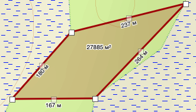

### Название и перенос в другие программы

В контекстном меню полигона откройте подменю объекта. Через **«Свойства»** можно изменить название и цвет.

**GeoJSON** сохраняет полигон вместе с его геометрией и свойствами. Также доступны копирование названия и координат обычным текстом и ссылка на границу области.

При сохранении в **GPX** внешний контур полигона передаётся как трек. Такой файл подходит для отображения границы в программах и навигаторах, работающих с треками; заливка области и свойства полигона этим способом не переносятся.

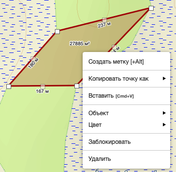

### Печать карты по границе полигона

Полигон можно использовать как границу печатаемой карты. Откройте его контекстное меню, перейдите в подменю объекта и нажмите **«Печать области…»**.

В окне печати выберите размер бумаги, ориентацию и разрешение. Название полигона подставляется в заголовок карты; его можно изменить перед подготовкой изображения.

Параметр **«Обрезать карту по контуру области (прозрачный фон)»** оставляет на изображении только карту внутри полигона. Всё за его границей обрезается, поэтому область печати может повторять произвольный контур.

Если снять этот флажок, в прямоугольную область печати попадёт и окружающая местность.

Нажмите **«Предпросмотр»**, чтобы подготовить результат и проверить его перед печатью.

### Скачивание карт внутри границы

Полигон можно использовать как область для подготовки карт без интернета. После входа в учётную запись откройте его контекстное меню и выберите **«Скачать карты…»**.

Команда доступна, когда браузер поддерживает используемый ГИС механизм локального хранения карт. Она открывает окно выбора слоёв и масштабов с уже заданной областью полигона.

Подробности приведены в разделе [«Работа без интернета»](https://help.gis.extremum.org/working-offline.html).

### Удаление

Команда **«Удалить»** убирает полигон с карты. Удаление можно отменить, пока соответствующее действие доступно в истории текущего окна ГИС.

## Окружности

Окружность позволяет обозначить область вокруг выбранного центра и посмотреть её радиус и площадь. Положение центра и размер задаются на карте; готовый объект можно перемещать, копировать и использовать как границу печатаемой карты.

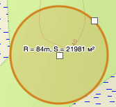

### Создание окружности

На панели инструментов нажмите **«Нарисовать окружность»**:

1. Первым нажатием на карте задайте центр.
2. Переместите указатель, чтобы подобрать размер.
3. Вторым нажатием укажите точку на границе и завершите построение.

На сенсорном экране или при работе пером последовательно коснитесь центра будущей окружности и точки на её границе.

При работе **мышью или тачпадом** окружность также можно растянуть одним движением: удерживайте **Shift** и выполните перетаскивание от центра к границе. Удерживайте Shift до конца движения; после завершения перетаскивания окружность будет построена.

**Escape** отменяет незавершённую окружность. Повторное нажатие **Escape** выключает инструмент рисования.

Размер определяется указанными точками. Фиксированная окружность радиусом 10 метров при первом нажатии не создаётся.

### Что означают радиус и площадь

Во время построения и редактирования возле центра показываются **R** — расчётный радиус — и площадь области. Радиус выводится в метрах или километрах, площадь — в **м²** или **км²**.

Радиус относится к расстоянию от центра до границы. Например, при **R = 500 м** поперечник области составляет примерно **1 км**.

Для измерения окружность представляется замкнутым контуром, площадь которого рассчитывается на **сферической модели Земли**, как у полигона. Затем из площади получается радиус круга с такой же площадью:

**R = √(S / π)**,

где **S** — рассчитанная площадь.

Таким образом, подпись учитывает географическое положение объекта, а не только его размер на экране. Подъёмы, склоны и неровности рельефа в расчёт не входят.

Сама окружность строится в проекции карты. Если переместить её далеко к северу или югу, отображаемые радиус и площадь могут измениться, хотя форма объекта на карте сохранится. Это связано с изменением масштаба проекции по широте.

### Изменение центра и размера

После построения окружность доступна для редактирования. Перетаскивание центра переносит объект, а перетаскивание границы изменяет его размер.

На компьютере маркер редактирования появляется при наведении на центр или границу. Пользуйтесь обычным для мыши или тачпада жестом перетаскивания. На сенсорном экране начинайте движение непосредственно от центра или границы окружности.

После изменения радиус и площадь пересчитываются. Изменение, сделанное перетаскиванием, можно отменить через **Ctrl+Z** на Windows/Linux или **Cmd+Z** на macOS, когда ввод не находится в текстовом поле.

Команда **«Заблокировать»** выключает редактирование и скрывает измерительные подписи. Окружность остаётся на карте. Чтобы снова менять её положение и размер, выберите **«Разблокировать»**.

Радиус задаётся и корректируется на карте. Окно **«Свойства»** в подменю объекта предназначено для изменения названия и цвета.

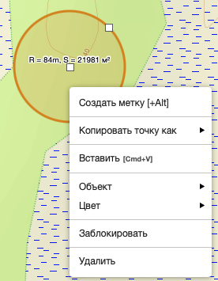

### Печать карты внутри окружности

Откройте контекстное меню окружности, перейдите в подменю объекта и нажмите **«Печать области…»**.

В окне печати можно выбрать размер бумаги, ориентацию, разрешение и заголовок. Параметр **«Обрезать карту по контуру области (прозрачный фон)»** оставляет изображение карты только внутри окружности.

Если снять этот флажок, в прямоугольную область печати попадёт и окружающая местность. Нажмите **«Предпросмотр»**, чтобы подготовить результат и проверить его перед печатью.

### Копирование и сохранение

В подменю объекта доступны копирование в **GeoJSON**, текстовая запись координат, ссылка на окружность и сохранение в **GPX**.

Для переноса между окнами ГИС используйте **«Скопировать GeoJSON»**. ГИС сохраняет центр и радиус и восстанавливает по ним окружность при вставке. В других программах такая запись может отображаться как точка центра: радиус передаётся дополнительным свойством объекта.

Команда **«Скопировать ссылку»** передаёт положение и размер окружности через адрес ГИС. Уже отправленная ссылка сохраняет эти параметры на момент копирования.

При сохранении в **GPX** граница превращается в замкнутый трек из коротких отрезков. Это позволяет показать её в программах и навигаторах, работающих с треками. Такое представление приближённо повторяет окружность и не сохраняет её как отдельный объект с редактируемым радиусом.

### Удаление

Команда **«Удалить»** убирает окружность с карты. Удаление можно отменить, пока соответствующее действие доступно в истории текущего окна ГИС.

## Управление объектами

Метки, маршруты и границы районов постепенно превращают карту в рабочую тетрадь поиска. Чтобы найти нужную запись, перенести её на другое устройство или убрать лишнее, откройте **«Управление объектами»** в главном меню.

В таблице собраны объекты, сохранённые на устройстве: метки, линии, полигоны, окружности, треки и сетки. Нажмите на имя или координаты объекта — карта переместится к нему. Отметьте несколько строк флажками, чтобы скопировать объекты, сохранить их в GPX или удалить. Флажок в заголовке выделяет весь список.

После входа в систему при наличии интернета появляется и вкладка **«Мои фотографии»** с фотографиями вашей учётной записи, сохранёнными на сервере.

### Как объекты попадают с компьютера на телефон

Представьте: вы готовите район поиска на большом экране, отмечаете место встречи и рисуете маршрут. Затем открываете ГИС на телефоне — и продолжаете работать с теми же объектами.

Посредником между устройствами служит **MWS Cloud**. Компьютер отправляет туда изменения, а телефон забирает их и сохраняет у себя. Для этого на обоих устройствах нужно войти **в одну учётную запись** и включить **«Синхронизацию»** в окне управления объектами. Возможность обмена должна быть доступна вашей учётной записи.

При первом использовании переключатель уже включён. Дальше браузер запоминает ваш выбор. Обмен работает, пока ГИС открыта и активна; само окно управления объектами можно закрыть.

У каждого устройства остаётся собственная локальная копия. Поэтому без связи можно продолжать рисовать и редактировать. Когда интернет вернётся и ГИС будет активна, устройства снова начнут обмениваться изменениями.

Обмен изменениями в реальном времени требует заметных ресурсов: облако принимает новые версии, сообщает о них другим устройствам и передаёт сами объекты. Благодаря спонсорской поддержке **[MWS Cloud — МТС Web Services](https://mws.ru/)** эта возможность бесплатно предоставляется всем авторизованным сотрудникам поисково-спасательных служб.

### Когда изменения считаются одновременными

Для синхронизации «одновременно» означает не обязательно одну и ту же секунду. Важнее другое: **успело ли второе устройство получить изменение первого перед своей правкой**.

Например, вы передвинули метку на компьютере. Телефон получил её новое положение, после чего вы изменили название на телефоне. Это последовательные изменения: телефон уже продолжает работу с обновлённой меткой.

Но если передвинуть одну метку на компьютере и телефоне, пока они ещё не получили изменения друг друга, появятся две конкурирующие версии.

ГИС делает небольшую паузу — **0,75 секунды** после изменения, прежде чем начать обмен. На принимающей стороне после уведомления об изменениях есть такая же пауза. Вместе это около **полутора секунд плюс время передачи и обработки данных**.

При хорошей связи правки с промежутком в несколько секунд часто уже оказываются последовательными. Чем меньше объект, тем быстрее он обычно передаётся и тем ближе по времени можно работать на разных устройствах без пересечения правок. Небольшая метка добирается до телефона быстрее, чем длинный трек с тысячами точек. При слабой связи промежуток увеличивается, а без интернета даже правки с разницей в несколько минут могут оказаться конкурирующими.

Система выбирает одну из версий по правилам сравнения версий; отдельные изменения внутри объекта автоматически не объединяются. Поэтому при работе с одним объектом на двух устройствах полезно дать изменениям дойти до второго устройства перед следующей правкой.

### Что показывает столбец «Синхр.»

Статус относится к текущей версии конкретного объекта:

- **Локально** — нет подтверждения её хранения в облаке в пределах действующего срока синхронизации.
- **Ожидание** — изменения ждут обмена.
- **Отправка** — версия отправляется в облако.
- **MWS Cloud** — эта версия сохранена на устройстве и в облаке. Другому устройству ещё может понадобиться время, чтобы её получить.
- **Ошибка** — обмену что-то помешало; подробности доступны в подсказке к статусу.

Надпись **«Синхронизировано, …»** рядом с переключателем показывает время последнего успешного обмена. Если важно проверить конкретную метку или маршрут, смотрите статус в его строке.

### Почему облако помнит объекты семь дней

Карта поиска живёт вместе с операцией: появляются новые ориентиры, меняются маршруты, уточняются границы районов. Но метка, полезная сегодня, через месяц может уже потерять смысл. Если бесконечно переносить всё накопленное между устройствами, новый телефон быстро заполнится следами старых поисков.

Поэтому у облачного обмена есть память ограниченной глубины: **по умолчанию семь дней с момента создания или последнего изменения объекта**. Это помогает устаревшим данным постепенно выходить из обмена, экономит мобильный трафик и оставляет на новом устройстве больше места для текущей работы. Простое открытие карты этот срок не продлевает.

Когда срок проходит, объект остаётся на устройствах, где уже сохранён, но его облачная версия выходит из обмена. Например, свежая метка места встречи появится на новом телефоне, а маршрут, нарисованный месяц назад и с тех пор не менявшийся, может остаться только на прежнем устройстве.

Если старый маршрут снова понадобился, его можно перенести вручную через копирование и вставку либо экспорт и импорт. Для длительного хранения результатов поиска сохраняйте отдельные файлы.

### Удаление тоже передаётся

Если удалить синхронизируемый объект, это изменение отправится на другие устройства. Поэтому очистка списка на телефоне может убрать тот же объект и с компьютера.

Выключение синхронизации останавливает обмен в этом браузере; локальные объекты остаются.

При временных сбоях ГИС повторяет попытки обмена. Если объект слишком велик или временное облачное хранилище заполнено, он остаётся доступным на устройстве. Подсказка к статусу **«Ошибка»** поможет понять причину.
